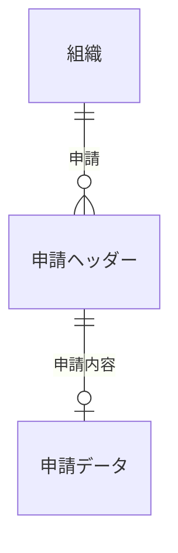
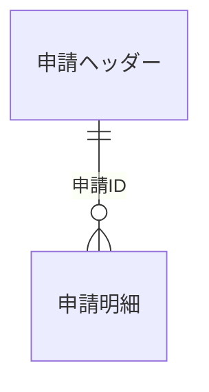

# DB設計 分割版 元データ・申請データ共通方針

## 変更履歴

| 変更日 | 変更内容 | 変更理由 |
| --- | --- | --- |
| 2026-08-12 | 申請ヘッダーの論理項目へ、物理設計に定義済みの申請者アカウント種別と申請者アカウントIDを追記した。 | 申請者識別項目が共通論理設計から欠落していたため。 |

## 目的

運用管理システムのDB設計を、共通方針と管理領域ごとの詳細に分けて整理する。

本資料は親資料として、管理領域に共通する考え方のみを扱う。

管理領域ごとの具体的な階層構造は、以下の子資料で扱う。

- `10_組織設定.md`
- `20_キーワード設定.md`
- `30_種別設定.md`
- `40_ユーザアカウント設定.md`
- `41_ユーザー設定値_参照元反映先.md`
- `50_SYNVOICE組織管理.md`
- `60_組織発行初期作成.md`
- `70_運用管理システムログイン.md`
- `80_請求根拠明細.md`

全体像と作業方針は、以下の関連資料で扱う。

- `00_全体ER図.md`

---

## 基本方針

現在有効な内容は **元データ** として保持する。

これから適用したい内容は **申請データ** として保持する。

申請データは、適用日に到達したタイミングで既存システムに参照される。既存システム側の反映処理が成功した後、運用管理システム側では申請データの内容を元データへ反映し、申請データを削除する。

```text
元データ
  現在有効な状態

申請データ
  次に適用したい状態

適用日
  バッチ処理対象を判定する日付
```

日次バッチは、毎日0:00に実行する。

日次バッチでは、組織別に、既存システム未登録組織の登録、適用日到来申請の反映、運用管理システム側の現状値更新、申請データ削除、請求根拠明細作成を行う。

ここで扱う日次バッチの流れは、既存システム側の処理を含む全体処理順である。

運用管理システム側の責務は、既存システム側の反映成功後に元データへ反映し、申請データを削除すること、および作成済み請求根拠明細を参照することに限定する。

適用処理が遅延した場合でも、申請ヘッダーの適用日は申請時に指定した元の適用日として扱い、実際の反映日で変更しない。

SYNVOICE管理者が管理する組織単位の契約・運用条件は、申請データとは別に `SYNVOICE組織管理` として保持する。

既存システムは、必要に応じてSYNVOICE組織管理の現在値を直接参照する想定とする。

この直接参照は、申請データを日次バッチで既存システムへ適用する流れとは別の扱いである。

---

## 申請ヘッダー

適用日、管理領域、申請単位キーなどの共通情報は **申請ヘッダー** に集約する。



申請ヘッダーは以下を表す。

```text
どの組織の
どの管理領域の
どの申請単位に対する
いつ適用する申請か
```

申請ヘッダーには、少なくとも以下の考え方を持たせる。

```text
申請ID
  申請ヘッダーを一意に識別するID

組織ID
  どの顧客組織の申請か

管理領域
  組織設定、ユーザアカウント設定、キーワード設定、種別設定など

申請単位キー
  管理領域ごとに、1件の申請が対象とする業務上のまとまりを識別するキー

適用日
  いつ反映する申請か
```

申請単位キーは、管理領域ごとに組織ID、ユーザIDなど異なる業務キーを格納するため、物理定義では文字列型を基本候補とする。

```text
申請単位キー:
  VARCHAR相当

比較・解釈:
  管理領域ごとの文脈で行う
```

数値IDを格納する管理領域であっても、申請ヘッダー共通項目としては文字列化して扱う。

これにより、管理領域ごとに申請ヘッダーの物理構造を分けず、同じ一意制約を適用できる。

---

## 主キーと一意制約

申請ヘッダーの主キーは、複合キーではなく **サロゲートキー** とする。

```text
主キー:
  申請ID
```

業務上、同じ申請単位に対する未適用申請を重複させないため、以下を一意にする。

```text
一意制約:
  組織ID + 管理領域 + 申請単位キー
```

これにより、以下を表現する。

```text
同じ組織の
同じ管理領域の
同じ申請単位に対する
未適用申請は1件まで
```

申請内容や申請明細は、申請IDで申請ヘッダーにぶら下げる。



---

## 論理テーブル構造

本章では、共通方針と想定クエリで使用する範囲の論理項目だけを記載する。

作成日時、更新日時、作成者、更新者、監査項目などの詳細設計項目はここでは扱わない。

### 申請ヘッダー

| 論理項目 | 説明 |
| --- | --- |
| 申請ID | 申請ヘッダーを一意に識別するID |
| 組織ID | どの顧客組織の申請か |
| 管理領域 | 組織設定、ユーザアカウント設定、キーワード設定、種別設定など |
| 申請単位キー | 管理領域ごとに、1件の申請が対象とする業務上のまとまりを識別するキー |
| 適用日 | 申請内容を反映する日 |
| 申請者アカウント種別 | 申請主体がユーザ向け管理アカウントかSYNVOICE運用アカウントかを識別する区分 |
| 申請者アカウントID | 申請を行った管理アカウントのID |

制約の考え方:

```text
主キー:
  申請ID

一意制約:
  組織ID + 管理領域 + 申請単位キー
```

---

## 元データと申請データの関係

元データは、現在有効な状態として組織に直接ひもづける。

申請データは、未来に適用したい状態として申請ヘッダーにひもづける。

```text
現在値:
  組織 ─ 元データ

申請値:
  組織 ─ 申請ヘッダー ─ 申請データ
```

申請データは、申請作成時に元データを丸コピーして作成する。

申請作成後は、申請データを元データとは独立したデータとして扱う。

---

## 管理領域ごとの申請単位キー

申請単位キーは、変更する明細行のIDではなく、申請ヘッダー1件でロックする業務上のまとまりを表す。

管理領域ごとの申請単位キーは、以下の考え方とする。

| 管理領域 | 申請単位 | 申請単位キーの考え方 |
| --- | --- | --- |
| 組織設定 | 組織ごと | 組織ID |
| キーワード設定 | 組織ごと | 組織ID |
| 種別設定 | 組織ごと | 組織ID |
| ユーザアカウント設定 | 1アカウントごと | ユーザID |

キーワード設定、種別設定は組織単位で設定一式を扱うため、申請単位キーは組織IDでよい。

この場合、キーワードキーや種別キーは申請明細内の行識別であり、申請ヘッダーの申請単位キーではない。

ユーザアカウント設定は1アカウント単位で扱うため、申請単位キーはユーザIDを基本とする。

---

## 明細を持つ申請

キーワード設定や種別設定のように、申請内容が複数行になる管理領域では、申請ヘッダーの下に申請明細を持たせる。

適用日は明細には持たせない。

適用日は申請ヘッダーだけに持たせる。

```text
申請ヘッダー
  適用日を持つ

申請明細
  適用日は持たない
  申請IDで申請ヘッダーにひもづく
```

---

## 内部キーの扱い

申請ヘッダーの主キーは、MySQL の `AUTO_INCREMENT` などで採番するサロゲートキーを基本候補とする。

一方で、キーワード設定や種別設定のようなネストした明細データは、全体一意のサロゲートキーを増やさず、親キーを含めた複合主キーで構成する。

```text
キーワード申請:
  申請ID + キーワードキー

表記のブレ申請:
  申請ID + キーワードキー + 表記ブレキー

種別申請:
  申請ID + 種別キー
```

明細キーは、親スコープ内で親子関係を維持するためのローカルキーである。

明細キーには、全体一意ID、外部公開ID、既存システム向けID、表示順としての意味を持たせない。

表示順は別項目で管理する。

画面側は、明細キーを永続的に保持しない。

画面は、入力値、親子構造、表示順、選択されたマスターIDを送信し、サーバー側が保存時に親配下で重複しないローカルキーを採番する。

この方針により、画面やビジネスロジックで UUID、ULID、採番テーブルなどを扱う必要を減らす。

---

## 申請データの変更・取消・適用

キーワード設定や種別設定のように、現在値も申請値も外部から明細単位で参照されない管理領域では、申請内容を一式で扱う。

申請変更時は、申請ヘッダーを残し、申請配下の明細を削除して、画面から送信された変更後の内容を挿入し直す。

```text
申請変更:
  申請ヘッダーをロック
  申請配下の明細を削除
  画面内容から申請明細を挿入
  必要に応じて申請ヘッダーの適用日を更新
```

申請取消時は、申請配下の明細と申請ヘッダーを削除する。

```text
申請取消:
  申請ヘッダーをロック
  申請配下の明細を削除
  申請ヘッダーを削除
```

適用時は、対象組織の現在値配下を削除し、申請値から現在値を挿入し直す。

```text
適用:
  申請ヘッダーをロック
  対象組織の現在値配下を削除
  申請値から現在値を挿入
  申請配下の明細を削除
  申請ヘッダーを削除
```

申請変更、申請取消、適用では、同じ申請に対する同時処理を避けるため、申請ヘッダーを `SELECT ... FOR UPDATE` でロックする。

ユーザは、適用日前日の19:59まで当該適用日の申請を作成・変更・取消できる。

適用日前日の20:00以降、ユーザは当該適用日の申請を作成・変更・取消できない。翌々日以降を適用日とする申請は操作できる。

ユーザ管理代行中のSYNVOICE運用管理者は、緊急の顧客要請へ対応するため、適用日前日の20:00以降も日付が変わるまで当該適用日の申請を作成・変更・取消できる。

適用日当日は、操作主体にかかわらず当該適用日の申請操作を受け付けない。受付可否は操作日時、適用日、操作主体および代行状態から算出し、申請データに受付確定状態やバッチ開始状態を追加しない。

ユーザ向け変更・取消期限の時刻は固定値として埋め込まず、設定値として変更できるようにする。

---

## バッチ処理での抽出

バッチ処理では、申請ヘッダーの適用日を見て対象を抽出する。

```text
申請ヘッダー.適用日 <= バッチ対象日
```

前回失敗などで申請が残っている場合も拾えるように、完全一致ではなく `適用日 <= バッチ対象日` とする。

これにより、管理領域をまたいで適用対象を一括抽出できる。

日次バッチは、組織別、適用日順に処理する想定とする。

適用対象となる申請が複数ある場合は、適用日が古いものから順に処理する。

請求確定日以前の適用日に関する処理が完了していない場合、請求根拠明細作成は実行しない。

請求根拠明細作成が必要なタイミングでは、請求根拠明細作成が完了するまで、請求確定日より先の適用日に関する処理は実行しない。

---

## 適用時のデータフロー

本章のデータフローは、既存システム側で検討中の日次バッチ処理を含む全体像である。

日次バッチ処理自体は本システムの担当スコープ外であり、既存システム側の処理方針変更により、処理順序や分岐条件が変更される可能性がある。

本システム側では、既存システム側の反映成功後に申請データを元データへ反映し、申請データを削除できるデータ構造を用意する。

現時点のバッチ処理の基本的な流れは以下である。

```text
1. 組織別に処理対象を判定する

2. 既存システムに未登録の組織を登録する

   既存システムへの組織登録に失敗した場合、当該組織の後続処理は実行しない。

3. 申請ヘッダーから適用対象を抽出する

4. 請求確定日との前後関係に応じて、必要な請求根拠明細作成を先に行う

5. 既存システムが申請データを参照し、既存システム側を更新する

6. 既存システム側の更新が成功した場合のみ、運用管理システム側で申請データの内容を元データへ反映する

7. 申請データと申請ヘッダーを削除する

8. 適用日と請求確定日が同日の場合、適用後の状態で請求根拠明細を作成する
```

申請データ削除が実行される時点では、それ以前の既存システム更新と運用管理システム側の元データ更新は成功済みである、という前提で扱う。

そのため、運用管理システム側では、元データ更新と申請データ削除を同一トランザクションで扱う。

```text
BEGIN
  申請データを元データへ反映
  申請データを削除
  申請ヘッダーを削除
COMMIT
```

途中で失敗した場合はロールバックし、申請データを残す。

申請履歴のユーザ画面参照や、申請データを履歴として保持する構造は今回のスコープ外とする。

---

## DB構成

既存システムDBと運用管理システムDBは、同一DBインスタンス内でスキーマを分ける構成とする。

既存システム側から運用管理システム側の申請データを参照する前提で、参照権限や接続設定を詳細設計で整理する。

既存システムへの反映処理自体は、既存システム側の責務として扱う。

---

## 想定クエリ

本章のSQLは、データ構造の妥当性を確認するための擬似SQLである。

物理名ではなく、設計上の論理名で記載する。

### 適用対象の申請を取得する

日次バッチでは、申請ヘッダーの適用日を見て対象を抽出する。

前回失敗などで申請が残っている場合も対象に含めるため、適用日は完全一致ではなく、バッチ対象日以前で抽出する。

```sql
SELECT
    申請ID,
    組織ID,
    管理領域,
    申請単位キー,
    適用日
FROM
    申請ヘッダー
WHERE
    適用日 <= :バッチ対象日
ORDER BY
    適用日,
    組織ID,
    管理領域,
    申請単位キー;
```

### ある組織の未適用申請一覧を取得する

ユーザーまたはSYNVOICE管理者が、組織単位で未適用申請を確認する想定である。

```sql
SELECT
    申請ID,
    管理領域,
    申請単位キー,
    適用日
FROM
    申請ヘッダー
WHERE
    組織ID = :組織ID
ORDER BY
    適用日,
    管理領域,
    申請単位キー;
```

### 同一管理領域・申請単位キーの未適用申請有無を確認する

新規申請作成時に、同じ申請単位の未適用申請が既に存在するかを確認する。

```sql
SELECT
    申請ID,
    適用日
FROM
    申請ヘッダー
WHERE
    組織ID = :組織ID
    AND 管理領域 = :管理領域
    AND 申請単位キー = :申請単位キー;
```

この条件に該当する申請が存在する場合、新規申請ではなく既存申請の変更・取消として扱う。

### 申請を取り消す

申請取消は、未適用申請を取り下げる操作である。

現在値は更新しない。

申請配下のデータと申請ヘッダーを同一トランザクションで削除する。

```sql
BEGIN;

SELECT
    申請ID
FROM
    申請ヘッダー
WHERE
    申請ID = :申請ID
FOR UPDATE;

-- 管理領域ごとの申請明細を削除する。
-- 例:
--   組織設定申請
--   キーワード設定申請、キーワード申請、表記のブレ申請
--   種別設定申請、種別申請、種別別要約メニュー申請、要約用辞書申請
--   ユーザー申請

DELETE FROM 申請ヘッダー
WHERE
    申請ID = :申請ID;

COMMIT;
```

削除順序は、子となる申請明細から親となる申請ヘッダーの順とする。
