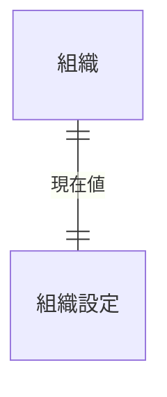
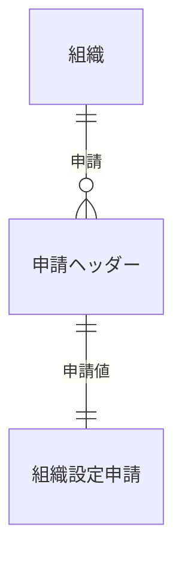

# DB設計 分割版 組織設定データ構造

## 変更履歴

| 変更日 | 変更内容 | 変更理由 |
| --- | --- | --- |
| 2026-08-06 | 現在値と申請値の同意文を任意項目とし、未設定を許容した。 | 2026-08-04決定事項により、同意文は必須入力ではないと確定したため。 |

## 目的

組織設定管理領域のデータ構造を整理する。

本資料では、組織設定固有のデータ範囲、キー、申請作成時のコピー、適用時の反映、想定クエリを扱う。

---

## 組織設定で扱う範囲

組織設定は、組織にぶら下がる設定として扱う。

組織そのものを識別する親データと、申請・適用対象となる組織設定は分ける。

```text
組織
  組織ID
  組織名

組織設定
  提供事業組織
  リアルタイムモニタリング利用有無
  追加認証設定
  同意文
```

組織名は、組織の代表名であるため、現在値は組織に持たせる。

ただし、社名変更は起こり得るため、組織設定申請の中で変更申請できる項目として扱う。

適用時は、組織設定申請の内容から組織と組織設定の両方を更新する。

```text
組織設定申請.組織名
  -> 組織.組織名

組織設定申請.その他設定
  -> 組織設定
```

---

## 現在値の構造



キー構造は以下とする。

```text
組織
  組織ID

組織設定
  組織ID
```

組織設定は、1組織につき1件である。

組織設定に別の組織設定IDは持たせず、組織IDを主キーとする。

組織と組織設定の現在値は、組織発行時に作成する。

組織名は、組織発行時の初期値として `組織` に作成され、その後は組織設定申請で変更可能な項目として扱う。

---

## 現在値の論理テーブル構造

本章では、想定クエリで使用する範囲の論理項目だけを記載する。

作成日時、更新日時、作成者、更新者、監査項目などの詳細設計項目はここでは扱わない。

### 組織

| 論理項目 | 説明 |
| --- | --- |
| 組織ID | 組織を一意に識別するID |
| 組織名 | 顧客の会社名。組織の代表名 |

### 組織設定

| 論理項目 | 説明 |
| --- | --- |
| 組織ID | 親となる組織 |
| 提供事業組織 | 組織に関する付加名称 |
| リアルタイムモニタリング利用有無 | リアルタイムモニタリング機能の利用有無 |
| 追加認証設定 | 二要素認証の組織デフォルト設定 |
| 同意文 | 録音同意文。未設定を許容する |

制約の考え方:

```text
組織:
  組織ID で一意

組織設定:
  組織ID で一意
```

---

## 申請値の構造

申請値側は、申請ヘッダーにひもづく。



申請値側の構造は以下とする。

```text
申請ヘッダー
  申請ID
  管理領域 = 組織設定
  申請単位キー = 組織ID
  適用日

組織設定申請
  申請ID
```

組織設定は組織単位で申請するため、申請単位キーは組織IDとする。

組織設定申請は1申請につき1件であり、申請IDを主キーとする。

---

## 申請値の論理テーブル構造

### 組織設定申請

| 論理項目 | 説明 |
| --- | --- |
| 申請ID | 親となる申請ヘッダー |
| 組織名 | 申請後に適用したい組織名 |
| 提供事業組織 | 申請後に適用したい提供事業組織 |
| リアルタイムモニタリング利用有無 | 申請後に適用したい利用有無 |
| 追加認証設定 | 申請後に適用したい組織デフォルトの追加認証設定 |
| 同意文 | 申請後に適用したい録音同意文。未設定を許容する |

---

## 申請作成時のコピー

組織設定申請は、差分ではなく、適用後の組織設定一式として保持する。

新規申請時は、現在値を申請値へコピーする。

```text
現在値:
  組織.組織名
  組織設定.提供事業組織
  組織設定.リアルタイムモニタリング利用有無
  組織設定.追加認証設定
  組織設定.同意文

申請値:
  組織設定申請.組織名
  組織設定申請.提供事業組織
  組織設定申請.リアルタイムモニタリング利用有無
  組織設定申請.追加認証設定
  組織設定申請.同意文
```

組織設定は明細を持たないため、ローカル明細キーは不要である。

---

## 申請変更時のデータ更新

組織設定申請は1申請につき1件である。

申請変更時は、申請ヘッダーをロックし、組織設定申請を更新する。

```text
申請変更:
  申請ヘッダーをロック
  組織設定申請を更新
  必要に応じて申請ヘッダーの適用日を更新
```

キーワード設定や種別設定のような明細再構築は不要である。

---

## 適用時の反映

組織設定は、申請値を現在値へ反映する。

運用管理システム側では以下を同一トランザクションで実行する。

```text
BEGIN
  申請ヘッダーをロック
  組織と組織設定をロック
  組織.組織名を更新
  組織設定を更新
  組織設定申請を削除
  申請ヘッダーを削除
COMMIT
```

組織名だけは組織に反映し、その他の組織設定項目は組織設定に反映する。

---

## SYNVOICE組織管理との境界

以下は、SYNVOICE管理者が管理する組織・契約系項目であり、ユーザ向け組織設定には含めない。

```text
録音可能時間下限
請求確定日
トライアル開始日
トライアル終了日
サービス本利用開始日
サービス本利用終了日
```

請求確定日や利用期間は、請求処理や契約状態に影響するため、ユーザ申請対象の組織設定とは分けて扱う。

---

## 追加認証設定の扱い

追加認証設定は、組織設定とユーザアカウント設定の両方に存在する。

```text
組織設定.追加認証設定
  組織デフォルト

ユーザアカウント設定.追加認証設定
  ユーザ個別設定
```

具体的な認証仕様や、ユーザ個別設定が未設定の場合に組織デフォルトを参照するかは、認証設計で検討する。

本資料では、ビジネス上の管理領域として別項目であることだけを整理する。

---

## 確認事項

組織設定については、以下を確認事項とする。

```text
組織名変更の申請権限
  組織名変更は、ユーザ管理者が申請できる項目としてよいか

SYNVOICE管理者の初期登録値との関係
  SYNVOICE管理者が初期登録した組織名を、ユーザ側申請で更新してよいか

請求根拠明細への反映
  請求根拠明細には、請求確定時点の変更後組織名を保持する理解でよいか
```

---

## 想定クエリ

本章のSQLは、データ構造の妥当性を確認するための擬似SQLである。

物理名ではなく、設計上の論理名で記載する。

### ある組織の現在組織設定を取得する

組織設定画面の初期表示や、既存システム反映時の現在値確認で使用する想定である。

```sql
SELECT
    組織.組織ID,
    組織.組織名,
    組織設定.提供事業組織,
    組織設定.リアルタイムモニタリング利用有無,
    組織設定.追加認証設定,
    組織設定.同意文
FROM
    組織
    INNER JOIN 組織設定
        ON 組織設定.組織ID = 組織.組織ID
WHERE
    組織.組織ID = :組織ID;
```

### ある申請IDの組織設定申請を取得する

申請編集画面、既存システム参照、バッチ適用時に使用する想定である。

```sql
SELECT
    申請ヘッダー.申請ID,
    申請ヘッダー.組織ID,
    申請ヘッダー.適用日,
    組織設定申請.組織名,
    組織設定申請.提供事業組織,
    組織設定申請.リアルタイムモニタリング利用有無,
    組織設定申請.追加認証設定,
    組織設定申請.同意文
FROM
    申請ヘッダー
    INNER JOIN 組織設定申請
        ON 組織設定申請.申請ID = 申請ヘッダー.申請ID
WHERE
    申請ヘッダー.申請ID = :申請ID;
```

### 新規申請作成時に現在値を申請値へコピーする

現在値から申請値を作成する。

```sql
INSERT INTO 組織設定申請 (
    申請ID,
    組織名,
    提供事業組織,
    リアルタイムモニタリング利用有無,
    追加認証設定,
    同意文
)
SELECT
    :申請ID,
    組織.組織名,
    組織設定.提供事業組織,
    組織設定.リアルタイムモニタリング利用有無,
    組織設定.追加認証設定,
    組織設定.同意文
FROM
    組織
    INNER JOIN 組織設定
        ON 組織設定.組織ID = 組織.組織ID
WHERE
    組織.組織ID = :組織ID;
```

### 申請変更時に組織設定申請を更新する

申請ヘッダーをロックしたうえで、申請値を更新する。

```sql
SELECT
    申請ID
FROM
    申請ヘッダー
WHERE
    申請ID = :申請ID
FOR UPDATE;

UPDATE 組織設定申請
SET
    組織名 = :組織名,
    提供事業組織 = :提供事業組織,
    リアルタイムモニタリング利用有無 = :リアルタイムモニタリング利用有無,
    追加認証設定 = :追加認証設定,
    同意文 = :同意文
WHERE
    申請ID = :申請ID;
```

### 適用時に組織設定申請を現在値へ反映する

ジョブネット上、ここに到達する時点では既存システム側の反映は成功済みである。

以下は論理的な処理順序である。

```sql
BEGIN;

SELECT
    申請ID
FROM
    申請ヘッダー
WHERE
    申請ID = :申請ID
FOR UPDATE;

UPDATE 組織
    INNER JOIN 申請ヘッダー
        ON 申請ヘッダー.組織ID = 組織.組織ID
    INNER JOIN 組織設定申請
        ON 組織設定申請.申請ID = 申請ヘッダー.申請ID
SET
    組織.組織名 = 組織設定申請.組織名
WHERE
    申請ヘッダー.申請ID = :申請ID;

UPDATE 組織設定
    INNER JOIN 申請ヘッダー
        ON 申請ヘッダー.組織ID = 組織設定.組織ID
    INNER JOIN 組織設定申請
        ON 組織設定申請.申請ID = 申請ヘッダー.申請ID
SET
    組織設定.提供事業組織 = 組織設定申請.提供事業組織,
    組織設定.リアルタイムモニタリング利用有無 = 組織設定申請.リアルタイムモニタリング利用有無,
    組織設定.追加認証設定 = 組織設定申請.追加認証設定,
    組織設定.同意文 = 組織設定申請.同意文
WHERE
    申請ヘッダー.申請ID = :申請ID;

DELETE FROM 組織設定申請
WHERE
    申請ID = :申請ID;

DELETE FROM 申請ヘッダー
WHERE
    申請ID = :申請ID;

COMMIT;
```

### 請求根拠明細作成時に組織名・提供事業組織を取得する

請求構造の詳細は請求データ設計で検討する。

ここでは、組織設定が請求根拠明細へ提供する組織属性だけを確認する。

```sql
SELECT
    組織.組織ID,
    組織.組織名,
    組織設定.提供事業組織
FROM
    組織
    INNER JOIN 組織設定
        ON 組織設定.組織ID = 組織.組織ID
WHERE
    組織.組織ID = :組織ID;
```
