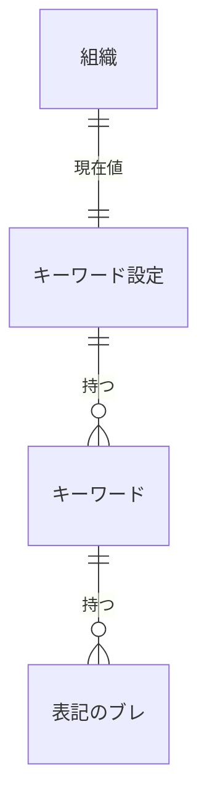
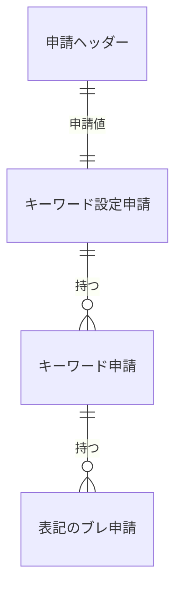

# DB設計 分割版 キーワード設定データ構造

## 目的

キーワード設定管理領域のデータ構造を整理する。

共通方針は `01_共通方針_元データ申請データ.md` を参照する。

本資料では、キーワード設定固有の階層構造、キー、申請作成時のコピー、適用時の反映を扱う。

---

## キーワード設定で扱う範囲

キーワード設定は、組織ごとに設定一式を持つ管理領域である。

画面上は、キーワードカードを複数持ち、各キーワードカードが表記のブレを複数持つ構造になっている。

そのため、データ構造は以下の3階層として扱う。

```text
キーワード設定
  └─ キーワード
      └─ 表記のブレ
```

---

## 現在値の構造

現在値側は、組織にキーワード設定をひもづけ、その配下にキーワード、さらにその配下に表記のブレを持つ。



キー構造は、階層ごとに親キーを参照する。

```text
組織
  組織ID

キーワード設定
  キーワード設定ID
  組織ID

キーワード
  キーワード設定ID
  キーワードキー

表記のブレ
  キーワード設定ID
  キーワードキー
  表記ブレキー
```

組織発行時は、キーワード設定の親、キーワード、表記のブレを初期設定から作成する。

初期設定にキーワードが存在しない場合は、キーワードと表記のブレは0件で作成される。

---

## 現在値の論理テーブル構造

本章では、想定クエリで使用する範囲の論理項目だけを記載する。

作成日時、更新日時、作成者、更新者、監査項目などの詳細設計項目はここでは扱わない。

### キーワード設定

| 論理項目 | 説明 |
| --- | --- |
| キーワード設定ID | キーワード設定を一意に識別するID |
| 組織ID | キーワード設定を保有する組織 |

制約の考え方:

```text
1組織につきキーワード設定は1件
```

### キーワード

| 論理項目 | 説明 |
| --- | --- |
| キーワード設定ID | 親となるキーワード設定 |
| キーワードキー | キーワード設定ID配下でキーワードを識別するローカルキー |
| 表示順 | キーワードの画面表示順、出力順 |
| キーワード名 | 画面に表示するキーワード名 |

制約の考え方:

```text
キーワード設定ID + キーワードキー で一意
```

### 表記のブレ

| 論理項目 | 説明 |
| --- | --- |
| キーワード設定ID | 親となるキーワード設定 |
| キーワードキー | 親となるキーワード |
| 表記ブレキー | キーワード設定ID + キーワードキー配下で表記のブレを識別するローカルキー |
| 表示順 | 表記のブレの表示順、出力順 |
| 表記 | キーワードに紐づく表記ゆれ |

制約の考え方:

```text
キーワード設定ID + キーワードキー + 表記ブレキー で一意
```

---

## 申請値の構造

申請値側も、現在値と同じ階層構造を持つ。

ただし、申請値は申請ヘッダーにひもづく。



申請値側の構造は以下とする。

```text
申請ヘッダー
  申請ID
  管理領域 = キーワード設定
  申請単位キー = 組織ID
  適用日

キーワード設定申請
  申請ID

キーワード申請
  申請ID
  キーワードキー

表記のブレ申請
  申請ID
  キーワードキー
  表記ブレキー
```

申請値側のキーワードキー、表記ブレキーは、申請IDの配下で親子関係を維持するためのローカルキーである。

```text
キーワード申請:
  申請ID + キーワードキー で一意

表記のブレ申請:
  申請ID + キーワードキー + 表記ブレキー で一意
```

---

## 申請値の論理テーブル構造

### キーワード設定申請

| 論理項目 | 説明 |
| --- | --- |
| 申請ID | 親となる申請ヘッダー |

### キーワード申請

| 論理項目 | 説明 |
| --- | --- |
| 申請ID | 親となる申請ヘッダー |
| キーワードキー | 申請ID配下でキーワードを識別するキー |
| 表示順 | キーワードの画面表示順、出力順 |
| キーワード名 | 申請後に適用したいキーワード名 |

### 表記のブレ申請

| 論理項目 | 説明 |
| --- | --- |
| 申請ID | 親となる申請ヘッダー |
| キーワードキー | 親となるキーワード申請 |
| 表記ブレキー | 申請ID + キーワードキー配下で表記のブレを識別するキー |
| 表示順 | 表記のブレの表示順、出力順 |
| 表記 | 申請後に適用したい表記ゆれ |

---

## 申請作成時のコピー

キーワード設定申請は、差分ではなく、適用後のキーワード設定一式として保持する。

そのため、新規申請時は、現在値を申請値へ丸ごとコピーする。

ただし、現在値側のキーと申請値側のキーは、外部キー関係として扱わない。

```text
現在値:
  キーワード設定ID + キーワードキー

申請値:
  申請ID + キーワードキー
```

コピー直後は同じキー値になり得るが、これは対応関係を示す補助情報にすぎない。

申請値側のキーは、元データを参照するためのキーではなく、申請内の親子関係を維持するためのキーである。

コピー直後や元データ由来の行については、キー値を使って元データと申請データを比較できる。

```text
元にも申請にも同じキーがある
  変更なし、または内容変更

元にあり、申請にない
  削除予定

元になく、申請にある
  追加予定
```

ただし、この比較は補助的なものであり、申請データは作成後、元データとは独立したデータとして扱う。

---

## 申請変更時のデータ更新

申請変更時は、キーワード申請配下を一式削除し、画面から送信された変更後の内容を挿入し直す。

画面側は、キーワードキーや表記ブレキーを永続的に保持しない。

```text
画面が送信するもの:
  キーワード名
  表記
  親子構造
  表示順

サーバー側が保存時に行うこと:
  申請ヘッダーをロック
  申請配下のキーワード申請、表記のブレ申請を削除
  表示順などをもとに親配下でローカルキーを採番
  申請明細を挿入
```

キーワードキー、表記ブレキーは、DB上の親子関係を表現するための値であり、画面上の行IDや既存システム向けIDではない。

同じ申請に対する同時変更を避けるため、申請変更時は申請ヘッダーを `SELECT ... FOR UPDATE` でロックする。

---

## 表示順

画面表示順は、キーではなく表示順で管理する。

```text
キー
  レコード識別のためだけに使う

表示順
  画面表示順、出力順を決める
```

キーワードの並び替えや表記のブレの並び替えでは、キーは変更せず、表示順だけを更新する。

ただし、申請変更時に申請配下をDELETE/INSERTで再構築する場合は、キー値が変わっても問題ない。

明細キーは外部参照されず、表示順は別項目で保持するためである。

---

## 既存システム向けIDとの分離

既存システムの反映先である `keyphrase-custom-setting.json` には `id` が存在する。

この `id` は、運用管理システム内部のキーとは別物として扱う。

```text
運用管理システム内部キー
  DB上のレコード識別と親子関係維持に使う

既存システム向けJSONのid
  既存システム反映時に必要な出力項目
```

既存システム向けJSONの `id` の生成・調整は、既存システム反映処理側で扱う。

運用管理システム側では、表示順を保持しておき、必要に応じて既存システム反映処理が表示順などをもとに `id` を生成する。

---

## 適用時の反映

キーワード設定は、差分適用ではなく一式置き換えで扱う。

運用管理システム側では以下を同一トランザクションで実行する。

```text
BEGIN
  対象組織の現在キーワード設定配下を削除
  申請側のキーワード設定配下を現在値側へコピー
  キーワード設定申請配下を削除
  申請ヘッダーを削除
COMMIT
```

この方式では、現在値側のキーワードキー、表記ブレキーも親スコープ内のローカルキーとして扱う。

適用時に申請値側のローカルキーを現在値側へコピーしてよいが、キー値自体に外部的な意味は持たせない。

---

## 考慮事項

キーワード設定については、以下を後続設計で具体化する。

```text
明細キーの採番
  画面では保持せず、保存時に親配下でローカルキーを採番する

キーワード件数
  画面上は最大10件、最低1件を想定する

表記のブレ件数
  各キーワードに最低1件必要かを確認する

重複チェック
  同じキーワード名を許可するか
  同じ表記のブレを同一キーワード内で許可するか
  同じ表記のブレを別キーワード間で許可するか

参照関係
  キーワード現在値を他機能が外部参照しない前提で、一式置き換えを採用する
```

---

## 想定クエリ

本章のSQLは、データ構造の妥当性を確認するための擬似SQLである。

物理名ではなく、設計上の論理名で記載する。

### ある組織の現在キーワード設定を取得する

キーワード設定画面の初期表示や、既存システム反映時の現在値確認で使用する想定である。

```sql
SELECT
    キーワード.キーワードキー,
    キーワード.表示順 AS キーワード表示順,
    キーワード.キーワード名,
    表記のブレ.表記ブレキー,
    表記のブレ.表示順 AS 表記ブレ表示順,
    表記のブレ.表記
FROM
    キーワード設定
    INNER JOIN キーワード
        ON キーワード.キーワード設定ID = キーワード設定.キーワード設定ID
    LEFT JOIN 表記のブレ
        ON 表記のブレ.キーワード設定ID = キーワード.キーワード設定ID
       AND 表記のブレ.キーワードキー = キーワード.キーワードキー
WHERE
    キーワード設定.組織ID = :組織ID
ORDER BY
    キーワード.表示順,
    表記のブレ.表示順;
```

### ある申請IDのキーワード設定申請を取得する

申請編集画面、既存システム参照、バッチ適用時に使用する想定である。

```sql
SELECT
    キーワード申請.キーワードキー,
    キーワード申請.表示順 AS キーワード表示順,
    キーワード申請.キーワード名,
    表記のブレ申請.表記ブレキー,
    表記のブレ申請.表示順 AS 表記ブレ表示順,
    表記のブレ申請.表記
FROM
    キーワード設定申請
    INNER JOIN キーワード申請
        ON キーワード申請.申請ID = キーワード設定申請.申請ID
    LEFT JOIN 表記のブレ申請
        ON 表記のブレ申請.申請ID = キーワード申請.申請ID
       AND 表記のブレ申請.キーワードキー = キーワード申請.キーワードキー
WHERE
    キーワード設定申請.申請ID = :申請ID
ORDER BY
    キーワード申請.表示順,
    表記のブレ申請.表示順;
```

### 新規申請作成時に現在値を申請値へコピーする

現在値から申請値を作成する。

申請値側のローカルキーは、現在値側のキーをコピーしてもよいが、外部キー関係として扱わない。

```sql
INSERT INTO キーワード設定申請 (
    申請ID
)
SELECT
    :申請ID
FROM
    キーワード設定
WHERE
    組織ID = :組織ID;
```

```sql
INSERT INTO キーワード申請 (
    申請ID,
    キーワードキー,
    表示順,
    キーワード名
)
SELECT
    :申請ID,
    キーワード.キーワードキー,
    キーワード.表示順,
    キーワード.キーワード名
FROM
    キーワード設定
    INNER JOIN キーワード
        ON キーワード.キーワード設定ID = キーワード設定.キーワード設定ID
WHERE
    キーワード設定.組織ID = :組織ID;
```

```sql
INSERT INTO 表記のブレ申請 (
    申請ID,
    キーワードキー,
    表記ブレキー,
    表示順,
    表記
)
SELECT
    :申請ID,
    キーワード.キーワードキー,
    表記のブレ.表記ブレキー,
    表記のブレ.表示順,
    表記のブレ.表記
FROM
    キーワード設定
    INNER JOIN キーワード
        ON キーワード.キーワード設定ID = キーワード設定.キーワード設定ID
    INNER JOIN 表記のブレ
        ON 表記のブレ.キーワード設定ID = キーワード.キーワード設定ID
       AND 表記のブレ.キーワードキー = キーワード.キーワードキー
WHERE
    キーワード設定.組織ID = :組織ID;
```

### 適用時に申請値を現在値へ一式反映する

ジョブネット上、ここに到達する時点では既存システム側の反映は成功済みである。

以下は論理的な処理順序である。

```sql
BEGIN;

SELECT
    申請ID
FROM
    申請ヘッダー
WHERE
    申請ID = :申請ID
FOR UPDATE;

SELECT
    キーワード設定ID
FROM
    キーワード設定
WHERE
    組織ID = :組織ID
FOR UPDATE;

DELETE FROM 表記のブレ
WHERE
    キーワード設定ID IN (
        SELECT
            キーワード設定.キーワード設定ID
        FROM
            キーワード設定
        WHERE
            キーワード設定.組織ID = :組織ID
    );

DELETE FROM キーワード
WHERE
    キーワード設定ID IN (
        SELECT
            キーワード設定ID
        FROM
            キーワード設定
        WHERE
            組織ID = :組織ID
    );

INSERT INTO キーワード (
    キーワード設定ID,
    キーワードキー,
    表示順,
    キーワード名
)
SELECT
    キーワード設定.キーワード設定ID,
    キーワード申請.キーワードキー,
    キーワード申請.表示順,
    キーワード申請.キーワード名
FROM
    キーワード設定
    INNER JOIN キーワード申請
        ON キーワード申請.申請ID = :申請ID
WHERE
    キーワード設定.組織ID = :組織ID;

INSERT INTO 表記のブレ (
    キーワード設定ID,
    キーワードキー,
    表記ブレキー,
    表示順,
    表記
)
SELECT
    キーワード設定.キーワード設定ID,
    表記のブレ申請.キーワードキー,
    表記のブレ申請.表記ブレキー,
    表記のブレ申請.表示順,
    表記のブレ申請.表記
FROM
    キーワード設定
    INNER JOIN 表記のブレ申請
        ON 表記のブレ申請.申請ID = :申請ID
WHERE
    キーワード設定.組織ID = :組織ID;

DELETE FROM 表記のブレ申請
WHERE
    申請ID = :申請ID;

DELETE FROM キーワード申請
WHERE
    申請ID = :申請ID;

DELETE FROM キーワード設定申請
WHERE
    申請ID = :申請ID;

DELETE FROM 申請ヘッダー
WHERE
    申請ID = :申請ID;

COMMIT;
```

### 申請を取り消す

キーワード設定申請の取消では、現在値は更新しない。

申請ヘッダーをロックし、申請側の子階層から順に削除する。

```sql
BEGIN;

SELECT
    申請ID
FROM
    申請ヘッダー
WHERE
    申請ID = :申請ID
    AND 管理領域 = 'キーワード設定'
FOR UPDATE;

DELETE FROM 表記のブレ申請
WHERE
    申請ID = :申請ID;

DELETE FROM キーワード申請
WHERE
    申請ID = :申請ID;

DELETE FROM キーワード設定申請
WHERE
    申請ID = :申請ID;

DELETE FROM 申請ヘッダー
WHERE
    申請ID = :申請ID;

COMMIT;
```
