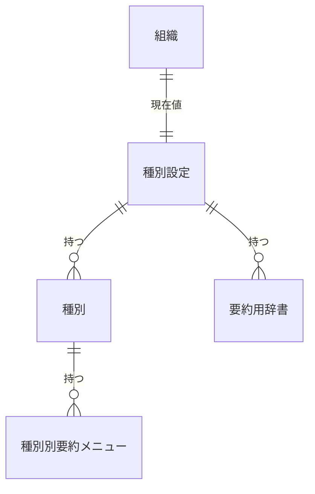
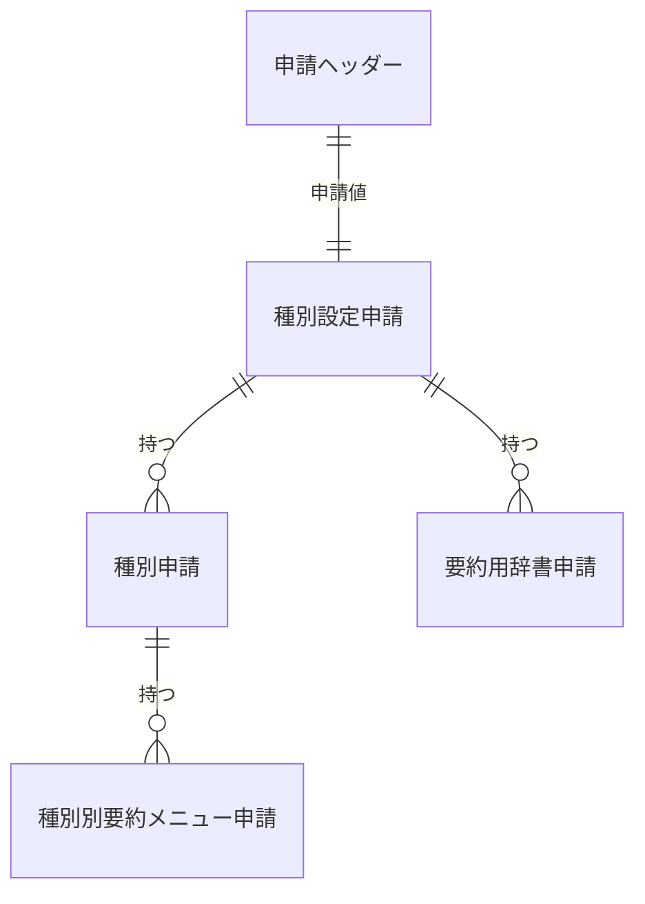
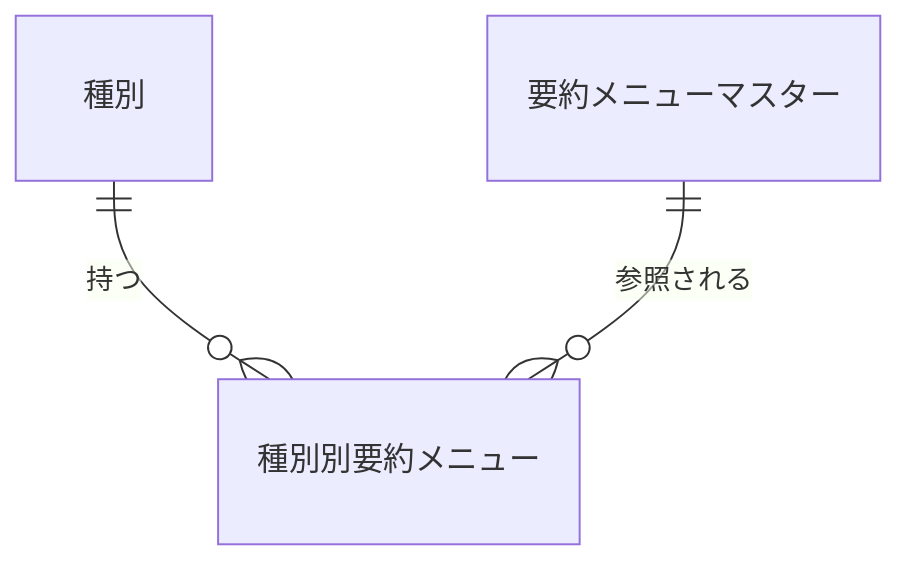
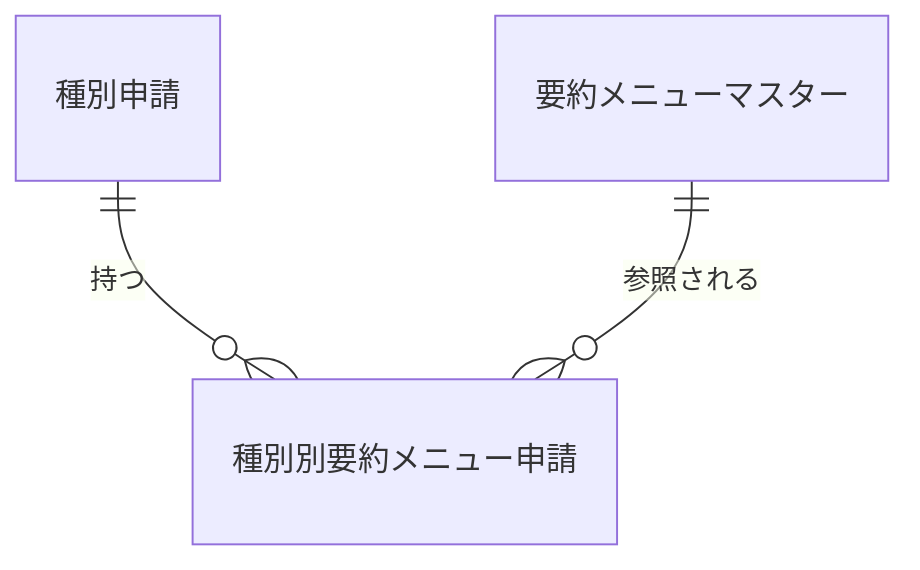
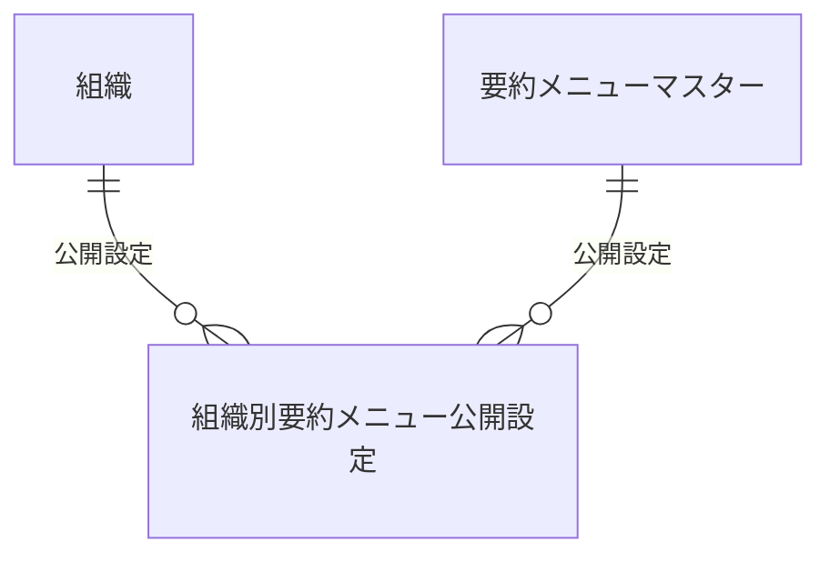

# DB設計 分割版 種別設定データ構造

## 目的

種別設定管理領域のデータ構造を整理する。

共通方針は `01_共通方針_元データ申請データ.md` を参照する。

本資料では、種別設定固有の階層構造、要約メニューマスターとの関係、組織別要約メニュー公開設定、課金要素、確認事項を扱う。

---

## 種別設定で扱う範囲

種別設定は、組織ごとに以下をまとめて扱う管理領域である。

```text
種別
種別ごとの要約メニュー
要約用辞書
要約メニュー数
```

申請ヘッダーとしては1件で扱う。

```text
申請ヘッダー
  管理領域 = 種別設定
  申請単位キー = 組織ID
```

データ構造は以下とする。

```text
種別設定
  ├─ 種別
  │   └─ 種別別要約メニュー
  └─ 要約用辞書
```

要約用辞書は、特定の種別にぶら下げず、種別設定全体にぶら下げる。

---

## 現在値の構造

現在値側は、組織に種別設定をひもづけ、その配下に種別、種別別要約メニュー、要約用辞書を持つ。



キー構造は、階層ごとに親キーを参照する。

```text
組織
  組織ID

種別設定
  種別設定ID
  組織ID

種別
  種別設定ID
  種別キー

種別別要約メニュー
  種別設定ID
  種別キー
  種別別要約メニューキー

要約用辞書
  種別設定ID
  辞書キー
```

---

## 現在値の論理テーブル構造

本章では、想定クエリで使用する範囲の論理項目だけを記載する。

作成日時、更新日時、作成者、更新者、監査項目などの詳細設計項目はここでは扱わない。

### 種別設定

| 論理項目 | 説明 |
| --- | --- |
| 種別設定ID | 種別設定を一意に識別するID |
| 組織ID | 種別設定を保有する組織 |
| 要約メニュー数 | 組織が利用できる要約メニュー種類数の上限。課金要素 |
| 要約メニュー数最終変更適用日 | 要約メニュー数を最後に変更した申請の適用日 |

制約の考え方:

```text
1組織につき種別設定は1件
```

### 種別

| 論理項目 | 説明 |
| --- | --- |
| 種別設定ID | 親となる種別設定 |
| 種別キー | 種別設定ID配下で種別を識別するローカルキー |
| 表示順 | 種別の画面表示順、出力順 |
| 種別名 | 録音内容の分類名 |

制約の考え方:

```text
種別設定ID + 種別キー で一意
```

### 種別別要約メニュー

| 論理項目 | 説明 |
| --- | --- |
| 種別設定ID | 親となる種別設定 |
| 種別キー | 親となる種別 |
| 種別別要約メニューキー | 種別設定ID + 種別キー配下で要約メニュー行を識別するローカルキー |
| 表示順 | 種別内での要約メニュー表示順、出力順 |
| メニュータイトル | 組織・種別内で表示するメニュータイトル |
| 要約メニューマスターID | 参照する要約メニューマスター |

制約の考え方:

```text
種別設定ID + 種別キー + 種別別要約メニューキー で一意
```

### 要約用辞書

| 論理項目 | 説明 |
| --- | --- |
| 種別設定ID | 親となる種別設定 |
| 辞書キー | 種別設定ID配下で辞書行を識別するローカルキー |
| 単語 | 要約時に使用する辞書単語 |
| 読み | 単語の読み |

制約の考え方:

```text
種別設定ID + 辞書キー で一意
```

### 要約メニューマスター

| 論理項目 | 説明 |
| --- | --- |
| 要約メニューマスターID | 要約メニューを一意に識別するマスターID |
| 要約メニュー名 | 要約メニューの名称 |
| 表示順 | 選択肢表示順 |

### 組織別要約メニュー公開設定

| 論理項目 | 説明 |
| --- | --- |
| 組織ID | 要約メニューを公開する組織 |
| 要約メニューマスターID | 公開対象の要約メニュー |

公開中の組み合わせだけを保持する方式を基本候補とする。

---

## 申請値の構造

申請値側も、現在値と同じ階層構造を持つ。

ただし、申請値は申請ヘッダーにひもづく。



申請値側の構造は以下とする。

```text
申請ヘッダー
  申請ID
  管理領域 = 種別設定
  申請単位キー = 組織ID
  適用日

種別設定申請
  申請ID
  要約メニュー数
  要約メニュー数最終変更適用日

種別申請
  申請ID
  種別キー

種別別要約メニュー申請
  申請ID
  種別キー
  種別別要約メニューキー

要約用辞書申請
  申請ID
  辞書キー
```

申請値側の各キーは、申請IDの配下で親子関係を維持するためのローカルキーである。

```text
種別申請:
  申請ID + 種別キー で一意

種別別要約メニュー申請:
  申請ID + 種別キー + 種別別要約メニューキー で一意

要約用辞書申請:
  申請ID + 辞書キー で一意
```

---

## 申請値の論理テーブル構造

### 種別設定申請

| 論理項目 | 説明 |
| --- | --- |
| 申請ID | 親となる申請ヘッダー |
| 要約メニュー数 | 申請後に適用したい要約メニュー数 |
| 要約メニュー数最終変更適用日 | 申請適用後の要約メニュー数最終変更適用日 |

### 種別申請

| 論理項目 | 説明 |
| --- | --- |
| 申請ID | 親となる申請ヘッダー |
| 種別キー | 申請ID配下で種別を識別するキー |
| 表示順 | 種別の画面表示順、出力順 |
| 種別名 | 申請後に適用したい種別名 |

### 種別別要約メニュー申請

| 論理項目 | 説明 |
| --- | --- |
| 申請ID | 親となる申請ヘッダー |
| 種別キー | 親となる種別申請 |
| 種別別要約メニューキー | 申請ID + 種別キー配下で要約メニュー行を識別するキー |
| 表示順 | 種別内での要約メニュー表示順、出力順 |
| メニュータイトル | 申請後に適用したいメニュータイトル |
| 要約メニューマスターID | 申請後に選択する要約メニューマスター |

### 要約用辞書申請

| 論理項目 | 説明 |
| --- | --- |
| 申請ID | 親となる申請ヘッダー |
| 辞書キー | 申請ID配下で辞書行を識別するキー |
| 単語 | 申請後に適用したい辞書単語 |
| 読み | 申請後に適用したい単語の読み |

---

## 申請作成時のコピー

種別設定申請は、差分ではなく、適用後の種別設定一式として保持する。

そのため、新規申請時は、現在値を申請値へ丸ごとコピーする。

ただし、現在値側のキーと申請値側のキーは、外部キー関係として扱わない。

```text
現在値:
  種別設定ID + 種別キー
  種別設定ID + 種別キー + 種別別要約メニューキー
  種別設定ID + 辞書キー

申請値:
  申請ID + 種別キー
  申請ID + 種別キー + 種別別要約メニューキー
  申請ID + 辞書キー
```

コピー直後は同じキー値になり得るが、これは対応関係を示す補助情報にすぎない。

申請値側のキーは、元データを参照するためのキーではなく、申請内の親子関係を維持するためのキーである。

申請データは作成後、元データとは独立したデータとして扱う。

---

## 申請変更時のデータ更新

申請変更時は、種別設定申請配下を一式削除し、画面から送信された変更後の内容を挿入し直す。

画面側は、種別キー、種別別要約メニューキー、辞書キーを永続的に保持しない。

```text
画面が送信するもの:
  種別名
  メニュータイトル
  要約メニューマスターID
  辞書単語、読み
  親子構造
  表示順

サーバー側が保存時に行うこと:
  申請ヘッダーをロック
  現在値と入力値を比較
  要約メニュー数最終変更適用日を再計算
  申請配下の種別申請、種別別要約メニュー申請、要約用辞書申請を削除
  表示順などをもとに親配下でローカルキーを採番
  申請明細を挿入
```

種別キー、種別別要約メニューキー、辞書キーは、DB上の親子関係を表現するための値であり、画面上の行IDや既存システム向けIDではない。

同じ申請に対する同時変更を避けるため、申請変更時は申請ヘッダーを `SELECT ... FOR UPDATE` でロックする。

---

## 表示順

画面表示順は、キーではなく表示順で管理する。

```text
種別の並び順
  種別側の表示順で管理する

種別内の要約メニュー並び順
  種別別要約メニュー側の表示順で管理する
```

並び替えではキーは変更せず、表示順だけを更新する。

ただし、申請変更時に申請配下をDELETE/INSERTで再構築する場合は、キー値が変わっても問題ない。

明細キーは外部参照されず、表示順は別項目で保持するためである。

---

## 要約メニューマスターとの関係

種別設定側には、要約メニューの本文、プロンプト、モデル設定、出力ファイル名などの実体は持たない。

それらは要約メニューマスター側で管理する。

種別別要約メニューには、選択された要約メニューマスターIDを持つ。



申請側も同じ考え方とする。



種別別要約メニューに持つ情報は、以下の範囲とする。

```text
種別別要約メニュー
  表示順
  メニュータイトル
  要約メニューマスターID
```

以下は種別設定側には持たない。

```text
プロンプト
モデル設定
出力ファイル名
references
```

---

## 組織別要約メニュー公開設定との関係

SYNVOICE管理者は、組織ごとに使用可能な要約メニューを設定する。

この設定は、種別設定申請のデータ構造には含めない。

役割は、ユーザーが種別設定申請を行うときの選択肢フィルターである。

```text
組織別要約メニュー公開設定
  選択可能な候補

種別設定申請
  選択された結果
```

画面表示時は、対象組織で公開中の要約メニューだけを選択肢に出す。

保存時も、選択された要約メニューマスターIDが対象組織で公開中か検証する。

要約メニュー数と公開設定件数の関係は、DB制約や保存時検証では制限しない。

```text
要約メニュー数 > 組織別要約メニュー公開設定の件数
  システム制御ではなく運用でカバーする
```

この関係を満たさない場合、要約メニュー数を増やしても選択可能な要約メニューが不足する。

具体的な対処方法は運用側で定める。

組織別要約メニュー公開設定は、組織と要約メニューマスターの多対多の関係として扱う。



公開中の組み合わせだけを保持する方式を基本候補とする。

```text
チェックON
  組織ID + 要約メニューマスターID のレコードを作成

チェックOFF
  組織ID + 要約メニューマスターID のレコードを削除
```

公開設定画面は、組織数と要約メニュー数が大きくない前提で、初期表示時に組織、要約メニュー、公開関係をまとめてJSON取得し、画面側で2方向表示、検索、選択済み/未選択フィルターを行う方式で対応できる。

公開設定を解除する場合は、現在値または未適用申請で使用中の要約メニューを解除不可とする。

画面表示時に、各 `組織ID + 要約メニューマスターID` の使用状態を取得し、解除不可のチェックボックスは操作不可にする。

```text
公開中 かつ 現在値または未適用申請で使用中
  チェック済み、操作不可

公開中 かつ 未使用
  チェック済み、操作可能

未公開
  未チェック、操作可能
```

保存時にも解除対象を再検証し、画面表示後に別セッションで使用状態が変わった場合は保存不可とする。

別セッションの変更を自動反映しないため、保存は差分保存を基本候補とする。

必要に応じてバージョンチェックで競合を検知する。

---

## 要約メニュー数と課金

要約メニュー数は、種別設定全体の属性として持つ。

```text
種別設定
  要約メニュー数
```

資料上、要約メニュー数は課金要素であり、請求情報として出力する項目である。

現時点では、要約メニュー数は「組織が利用できる要約メニュー種類数の上限」として扱う想定とする。

種別ごとに配置された要約メニュー行数の合計ではない想定である。

例:

```text
要約メニュー数 = 2

種別A:
  要約
  備忘録

種別B:
  要約
  備忘録
```

この場合、課金上の要約メニュー数は2と解釈する想定である。

ただし、最終的な課金解釈は顧客確認事項とする。

保存時は、各種別に設定された要約メニュー数が、種別設定全体の要約メニュー数を超えないことを検証する。

```text
各種別の要約メニュー設定数 <= 要約メニュー数
```

要約メニュー数と組織別要約メニュー公開設定件数の関係は、システム制御ではなく運用でカバーする。

```text
要約メニュー数 > 組織別要約メニュー公開設定の件数
  DB制約や保存時検証では制限しない
```

要約メニュー数は上限値であり、各種別が必ず上限いっぱいまで要約メニューを設定する必要はない想定である。

---

## 要約メニュー数最終変更適用日の扱い

要約メニュー数最終変更適用日は、要約メニュー数変更後の1か月制限を判定するための管理項目である。

申請データには、画面入力項目ではなく内部項目として要約メニュー数最終変更適用日を持つ。

特別な状態項目や変更有無フラグは持たせない。

申請作成・申請変更時に、現在値と入力値を比較して要約メニュー数最終変更適用日を再計算し、申請値に混ぜ込む。

```text
要約メニュー数に変更なし:
  種別設定申請.要約メニュー数最終変更適用日
    = 種別設定.要約メニュー数最終変更適用日

要約メニュー数に変更あり:
  種別設定申請.要約メニュー数最終変更適用日
    = 申請ヘッダー.適用日
```

適用時は、他項目と同じく申請値を現在値へ反映する。

```text
種別設定.要約メニュー数最終変更適用日
  = 種別設定申請.要約メニュー数最終変更適用日
```

組織発行時は、要約メニュー数最終変更適用日を組織発行日で初期化する。

サービス本利用開始日が設定された場合は、サービス本利用開始日で更新する。

---

## 組織発行時の初期値

組織発行時は、種別設定の現在値を初期値として作成する。

```text
要約メニュー数:
  2

種別名:
  商談

メニュータイトル:
  要約

要約メニューマスターID:
  GP001_01
```

要約メニュー数と組織別要約メニュー公開設定件数の不整合は、システム制御ではなく運用でカバーする。

---

## 既存システム向けIDとの分離

既存システムの反映先である `summary-format.json` には `format_id` が存在する。

この `format_id` は、運用管理システム内部のキーとは別物として扱う。

```text
運用管理システム内部キー
  DB上のレコード識別と親子関係維持に使う

既存システム向けformat_id
  既存システム反映時に必要な出力項目
```

既存システム向け `format_id` の生成・調整は、既存システム反映処理側で扱う。

---

## 適用時の反映

種別設定は、差分適用ではなく一式置き換えで扱う。

運用管理システム側では以下を同一トランザクションで実行する。

```text
BEGIN
  対象組織の現在種別設定配下を削除
  申請側の種別設定配下を現在値側へコピー
  種別設定申請配下を削除
  申請ヘッダーを削除
COMMIT
```

この方式では、現在値側の種別キー、種別別要約メニューキー、辞書キーも親スコープ内のローカルキーとして扱う。

適用時に申請値側のローカルキーを現在値側へコピーしてよいが、キー値自体に外部的な意味は持たせない。

---

## 確認事項

種別設定については、以下を確認事項とする。

```text
要約メニュー数の課金解釈
  組織が利用できる要約メニュー種類数の上限として課金する理解でよいか
  種別ごとの配置数合計ではない理解でよいか

公開設定解除不可制御
  現在値または未適用申請で使用中の要約メニューは、
  組織別要約メニュー公開設定画面で解除不可とする方針でよいか
  画面表示時に解除可否を取得し、解除不可のチェックボックスを操作不可にする方針でよいか

要約メニューマスター変更の影響
  申請後、適用前に要約メニューマスター内容が変更された場合、
  適用時は最新マスター内容を使う前提でよいか

要約メニューマスターIDの運用
  要約メニューマスターIDは不変とする
  内容変更時もIDは変更しない
  削除やID変更が必要な場合は、参照中データへの影響を事前確認する

公開設定画面の同時編集
  複数のSYNVOICE管理者が同時に公開設定を編集する可能性があるか
  後勝ちでよいか、競合検知が必要か

件数・重複制約
  種別名の重複を許可するか
  1組織あたり種別は最大何件か
  同じ種別内で同じ要約メニューは複数選択できない制約としてよいか
  辞書の単語 + 読みの重複は許可しない理解でよいか
```

---

## 現時点で扱わない事項

以下は、DB構造ではなく画面設計または顧客判断に寄るため、現時点では詳細化しない。

```text
SYNVOICE管理者向けの申請差分確認画面
  顧客申請を基本的にそのまま適用する前提では優先度が低い

辞書が種別設定管理領域に含まれることのUI/UX上の見せ方
  資料上は種別設定管理領域に含める前提とし、画面導線は別途検討する

明細キーの採番
  画面では保持せず、保存時に親配下でローカルキーを採番する
```

---

## 想定クエリ

本章のSQLは、データ構造の妥当性を確認するための擬似SQLである。

物理名ではなく、設計上の論理名で記載する。

### ある組織の現在種別設定を取得する

種別設定画面の初期表示や、既存システム反映時の現在値確認で使用する想定である。

```sql
SELECT
    種別設定.要約メニュー数,
    種別設定.要約メニュー数最終変更適用日,
    種別.種別キー,
    種別.表示順 AS 種別表示順,
    種別.種別名,
    種別別要約メニュー.種別別要約メニューキー,
    種別別要約メニュー.表示順 AS 要約メニュー表示順,
    種別別要約メニュー.メニュータイトル,
    種別別要約メニュー.要約メニューマスターID
FROM
    種別設定
    INNER JOIN 種別
        ON 種別.種別設定ID = 種別設定.種別設定ID
    LEFT JOIN 種別別要約メニュー
        ON 種別別要約メニュー.種別設定ID = 種別.種別設定ID
       AND 種別別要約メニュー.種別キー = 種別.種別キー
WHERE
    種別設定.組織ID = :組織ID
ORDER BY
    種別.表示順,
    種別別要約メニュー.表示順;
```

### ある組織の現在要約用辞書を取得する

要約用辞書画面の初期表示や、既存システム反映時の現在値確認で使用する想定である。

```sql
SELECT
    要約用辞書.辞書キー,
    要約用辞書.単語,
    要約用辞書.読み
FROM
    種別設定
    INNER JOIN 要約用辞書
        ON 要約用辞書.種別設定ID = 種別設定.種別設定ID
WHERE
    種別設定.組織ID = :組織ID
ORDER BY
    要約用辞書.単語,
    要約用辞書.読み;
```

### ある申請IDの種別設定申請を取得する

申請編集画面、既存システム参照、バッチ適用時に使用する想定である。

```sql
SELECT
    種別設定申請.要約メニュー数,
    種別設定申請.要約メニュー数最終変更適用日,
    種別申請.種別キー,
    種別申請.表示順 AS 種別表示順,
    種別申請.種別名,
    種別別要約メニュー申請.種別別要約メニューキー,
    種別別要約メニュー申請.表示順 AS 要約メニュー表示順,
    種別別要約メニュー申請.メニュータイトル,
    種別別要約メニュー申請.要約メニューマスターID
FROM
    種別設定申請
    INNER JOIN 種別申請
        ON 種別申請.申請ID = 種別設定申請.申請ID
    LEFT JOIN 種別別要約メニュー申請
        ON 種別別要約メニュー申請.申請ID = 種別申請.申請ID
       AND 種別別要約メニュー申請.種別キー = 種別申請.種別キー
WHERE
    種別設定申請.申請ID = :申請ID
ORDER BY
    種別申請.表示順,
    種別別要約メニュー申請.表示順;
```

### ある申請IDの要約用辞書申請を取得する

```sql
SELECT
    要約用辞書申請.辞書キー,
    要約用辞書申請.単語,
    要約用辞書申請.読み
FROM
    要約用辞書申請
WHERE
    要約用辞書申請.申請ID = :申請ID
ORDER BY
    要約用辞書申請.単語,
    要約用辞書申請.読み;
```

### 種別設定申請画面で選択可能な要約メニューを取得する

組織別要約メニュー公開設定を使い、対象組織で公開中の要約メニューだけを選択肢に出す。

```sql
SELECT
    要約メニューマスター.要約メニューマスターID,
    要約メニューマスター.要約メニュー名,
    要約メニューマスター.表示順
FROM
    要約メニューマスター
    INNER JOIN 組織別要約メニュー公開設定
        ON 組織別要約メニュー公開設定.要約メニューマスターID = 要約メニューマスター.要約メニューマスターID
WHERE
    組織別要約メニュー公開設定.組織ID = :組織ID
ORDER BY
    要約メニューマスター.表示順;
```

### 種別設定申請保存時に選択メニューが公開中か検証する

申請データに含まれる要約メニューマスターIDが、対象組織で公開中かを保存時に確認する。

```sql
SELECT
    種別別要約メニュー申請.要約メニューマスターID
FROM
    種別別要約メニュー申請
WHERE
    種別別要約メニュー申請.申請ID = :申請ID
    AND NOT EXISTS (
        SELECT
            1
        FROM
            組織別要約メニュー公開設定
        WHERE
            組織別要約メニュー公開設定.組織ID = :組織ID
            AND 組織別要約メニュー公開設定.要約メニューマスターID = 種別別要約メニュー申請.要約メニューマスターID
    );
```

この結果が0件であれば、申請内の要約メニューはすべて公開中である。

### 要約メニュー公開設定を要約メニュー視点で取得する

「要約メニューごとに会社を設定」画面で、ある要約メニューに対する組織ごとの公開状態を表示する想定である。

現在値または未適用申請で使用中の公開設定は、解除不可として返す。

```sql
SELECT
    組織.組織ID,
    組織.組織名,
    CASE
        WHEN 組織別要約メニュー公開設定.組織ID IS NULL THEN '未選択'
        ELSE '選択済み'
    END AS 公開状態,
    CASE
        WHEN 組織別要約メニュー公開設定.組織ID IS NULL THEN '対象外'
        WHEN 使用中現在値.要約メニューマスターID IS NOT NULL THEN '解除不可'
        WHEN 使用中申請.要約メニューマスターID IS NOT NULL THEN '解除不可'
        ELSE '解除可能'
    END AS 解除可否
FROM
    組織
    LEFT JOIN 組織別要約メニュー公開設定
        ON 組織別要約メニュー公開設定.組織ID = 組織.組織ID
       AND 組織別要約メニュー公開設定.要約メニューマスターID = :要約メニューマスターID
    LEFT JOIN 使用中現在値
        ON 使用中現在値.組織ID = 組織.組織ID
       AND 使用中現在値.要約メニューマスターID = :要約メニューマスターID
    LEFT JOIN 使用中申請
        ON 使用中申請.組織ID = 組織.組織ID
       AND 使用中申請.要約メニューマスターID = :要約メニューマスターID
WHERE
    組織.組織名 LIKE :検索文字列
ORDER BY
    組織.組織名;
```

### 要約メニュー公開設定を組織視点で取得する

「会社ごとに要約メニューを設定」画面で、ある組織に対する要約メニューごとの公開状態を表示する想定である。

現在値または未適用申請で使用中の公開設定は、解除不可として返す。

```sql
SELECT
    要約メニューマスター.要約メニューマスターID,
    要約メニューマスター.要約メニュー名,
    CASE
        WHEN 組織別要約メニュー公開設定.要約メニューマスターID IS NULL THEN '未選択'
        ELSE '選択済み'
    END AS 公開状態,
    CASE
        WHEN 組織別要約メニュー公開設定.要約メニューマスターID IS NULL THEN '対象外'
        WHEN 使用中現在値.要約メニューマスターID IS NOT NULL THEN '解除不可'
        WHEN 使用中申請.要約メニューマスターID IS NOT NULL THEN '解除不可'
        ELSE '解除可能'
    END AS 解除可否
FROM
    要約メニューマスター
    LEFT JOIN 組織別要約メニュー公開設定
        ON 組織別要約メニュー公開設定.要約メニューマスターID = 要約メニューマスター.要約メニューマスターID
       AND 組織別要約メニュー公開設定.組織ID = :組織ID
    LEFT JOIN 使用中現在値
        ON 使用中現在値.組織ID = :組織ID
       AND 使用中現在値.要約メニューマスターID = 要約メニューマスター.要約メニューマスターID
    LEFT JOIN 使用中申請
        ON 使用中申請.組織ID = :組織ID
       AND 使用中申請.要約メニューマスターID = 要約メニューマスター.要約メニューマスターID
WHERE
    要約メニューマスター.要約メニュー名 LIKE :検索文字列
ORDER BY
    要約メニューマスター.表示順;
```

`使用中現在値`、`使用中申請` は、要約メニューが現在値または未適用申請で参照されているかを表すサブクエリである。

```sql
使用中現在値:
SELECT DISTINCT
    種別設定.組織ID,
    種別別要約メニュー.要約メニューマスターID
FROM
    種別設定
    INNER JOIN 種別別要約メニュー
        ON 種別別要約メニュー.種別設定ID = 種別設定.種別設定ID

使用中申請:
SELECT DISTINCT
    申請ヘッダー.組織ID,
    種別別要約メニュー申請.要約メニューマスターID
FROM
    申請ヘッダー
    INNER JOIN 種別別要約メニュー申請
        ON 種別別要約メニュー申請.申請ID = 申請ヘッダー.申請ID
WHERE
    申請ヘッダー.管理領域 = '種別設定';
```

### 新規申請作成時に現在値を申請値へコピーする

現在値から申請値を作成する。

申請値側のローカルキーは、現在値側のキーをコピーしてもよいが、外部キー関係として扱わない。

```sql
INSERT INTO 種別設定申請 (
    申請ID,
    要約メニュー数,
    要約メニュー数最終変更適用日
)
SELECT
    :申請ID,
    種別設定.要約メニュー数,
    種別設定.要約メニュー数最終変更適用日
FROM
    種別設定
WHERE
    種別設定.組織ID = :組織ID;
```

### 要約メニュー数変更可否を判定する

要約メニュー数は課金要素のため、直近変更から1か月経過しているかを確認する。

```sql
SELECT
    種別設定.種別設定ID
FROM
    種別設定
WHERE
    種別設定.組織ID = :組織ID
    AND 種別設定.要約メニュー数最終変更適用日 <= :判定日 - INTERVAL 1 MONTH;
```

`:判定日` は、申請作成時または画面制御時の判定基準日を表す。

要約メニュー数を変更しない場合、この判定は不要である。

### 申請変更時に種別設定申請を更新する

申請ヘッダーをロックしたうえで、現在値と入力値から要約メニュー数最終変更適用日を再計算する。

```sql
SELECT
    申請ID
FROM
    申請ヘッダー
WHERE
    申請ID = :申請ID
FOR UPDATE;

UPDATE 種別設定申請
    INNER JOIN 申請ヘッダー
        ON 申請ヘッダー.申請ID = 種別設定申請.申請ID
    INNER JOIN 種別設定
        ON 種別設定.組織ID = 申請ヘッダー.組織ID
SET
    種別設定申請.要約メニュー数 = :要約メニュー数,
    種別設定申請.要約メニュー数最終変更適用日 =
        CASE
            WHEN 種別設定.要約メニュー数 <> :要約メニュー数
            THEN 申請ヘッダー.適用日
            ELSE 種別設定.要約メニュー数最終変更適用日
        END
WHERE
    種別設定申請.申請ID = :申請ID;
```

```sql
INSERT INTO 種別申請 (
    申請ID,
    種別キー,
    表示順,
    種別名
)
SELECT
    :申請ID,
    種別.種別キー,
    種別.表示順,
    種別.種別名
FROM
    種別設定
    INNER JOIN 種別
        ON 種別.種別設定ID = 種別設定.種別設定ID
WHERE
    種別設定.組織ID = :組織ID;
```

```sql
INSERT INTO 種別別要約メニュー申請 (
    申請ID,
    種別キー,
    種別別要約メニューキー,
    表示順,
    メニュータイトル,
    要約メニューマスターID
)
SELECT
    :申請ID,
    種別.種別キー,
    種別別要約メニュー.種別別要約メニューキー,
    種別別要約メニュー.表示順,
    種別別要約メニュー.メニュータイトル,
    種別別要約メニュー.要約メニューマスターID
FROM
    種別設定
    INNER JOIN 種別
        ON 種別.種別設定ID = 種別設定.種別設定ID
    INNER JOIN 種別別要約メニュー
        ON 種別別要約メニュー.種別設定ID = 種別.種別設定ID
       AND 種別別要約メニュー.種別キー = 種別.種別キー
WHERE
    種別設定.組織ID = :組織ID;
```

```sql
INSERT INTO 要約用辞書申請 (
    申請ID,
    辞書キー,
    単語,
    読み
)
SELECT
    :申請ID,
    要約用辞書.辞書キー,
    要約用辞書.単語,
    要約用辞書.読み
FROM
    種別設定
    INNER JOIN 要約用辞書
        ON 要約用辞書.種別設定ID = 種別設定.種別設定ID
WHERE
    種別設定.組織ID = :組織ID;
```

### 適用時に申請値を現在値へ一式反映する

ジョブネット上、ここに到達する時点では既存システム側の反映は成功済みである。

以下は論理的な処理順序である。

```sql
BEGIN;

SELECT
    申請ID
FROM
    申請ヘッダー
WHERE
    申請ID = :申請ID
FOR UPDATE;

SELECT
    種別設定ID
FROM
    種別設定
WHERE
    組織ID = :組織ID
FOR UPDATE;

DELETE FROM 種別別要約メニュー
WHERE
    種別設定ID IN (
        SELECT
            種別設定.種別設定ID
        FROM
            種別設定
        WHERE
            種別設定.組織ID = :組織ID
    );

DELETE FROM 種別
WHERE
    種別設定ID IN (
        SELECT
            種別設定.種別設定ID
        FROM
            種別設定
        WHERE
            種別設定.組織ID = :組織ID
    );

DELETE FROM 要約用辞書
WHERE
    種別設定ID IN (
        SELECT
            種別設定.種別設定ID
        FROM
            種別設定
        WHERE
            種別設定.組織ID = :組織ID
    );

UPDATE 種別設定
    INNER JOIN 種別設定申請
        ON 種別設定申請.申請ID = :申請ID
SET
    種別設定.要約メニュー数 = 種別設定申請.要約メニュー数,
    種別設定.要約メニュー数最終変更適用日 = 種別設定申請.要約メニュー数最終変更適用日
WHERE
    種別設定.組織ID = :組織ID;

INSERT INTO 種別 (
    種別設定ID,
    種別キー,
    表示順,
    種別名
)
SELECT
    種別設定.種別設定ID,
    種別申請.種別キー,
    種別申請.表示順,
    種別申請.種別名
FROM
    種別設定
    INNER JOIN 種別申請
        ON 種別申請.申請ID = :申請ID
WHERE
    種別設定.組織ID = :組織ID;

INSERT INTO 種別別要約メニュー (
    種別設定ID,
    種別キー,
    種別別要約メニューキー,
    表示順,
    メニュータイトル,
    要約メニューマスターID
)
SELECT
    種別設定.種別設定ID,
    種別別要約メニュー申請.種別キー,
    種別別要約メニュー申請.種別別要約メニューキー,
    種別別要約メニュー申請.表示順,
    種別別要約メニュー申請.メニュータイトル,
    種別別要約メニュー申請.要約メニューマスターID
FROM
    種別設定
    INNER JOIN 種別別要約メニュー申請
        ON 種別別要約メニュー申請.申請ID = :申請ID
WHERE
    種別設定.組織ID = :組織ID;

INSERT INTO 要約用辞書 (
    種別設定ID,
    辞書キー,
    単語,
    読み
)
SELECT
    種別設定.種別設定ID,
    要約用辞書申請.辞書キー,
    要約用辞書申請.単語,
    要約用辞書申請.読み
FROM
    種別設定
    INNER JOIN 要約用辞書申請
        ON 要約用辞書申請.申請ID = :申請ID
WHERE
    種別設定.組織ID = :組織ID;

DELETE FROM 種別別要約メニュー申請
WHERE
    申請ID = :申請ID;

DELETE FROM 種別申請
WHERE
    申請ID = :申請ID;

DELETE FROM 要約用辞書申請
WHERE
    申請ID = :申請ID;

DELETE FROM 種別設定申請
WHERE
    申請ID = :申請ID;

DELETE FROM 申請ヘッダー
WHERE
    申請ID = :申請ID;

COMMIT;
```

### 申請を取り消す

種別設定申請の取消では、現在値は更新しない。

申請ヘッダーをロックし、申請側の子階層から順に削除する。

```sql
BEGIN;

SELECT
    申請ID
FROM
    申請ヘッダー
WHERE
    申請ID = :申請ID
    AND 管理領域 = '種別設定'
FOR UPDATE;

DELETE FROM 種別別要約メニュー申請
WHERE
    申請ID = :申請ID;

DELETE FROM 種別申請
WHERE
    申請ID = :申請ID;

DELETE FROM 要約用辞書申請
WHERE
    申請ID = :申請ID;

DELETE FROM 種別設定申請
WHERE
    申請ID = :申請ID;

DELETE FROM 申請ヘッダー
WHERE
    申請ID = :申請ID;

COMMIT;
```
