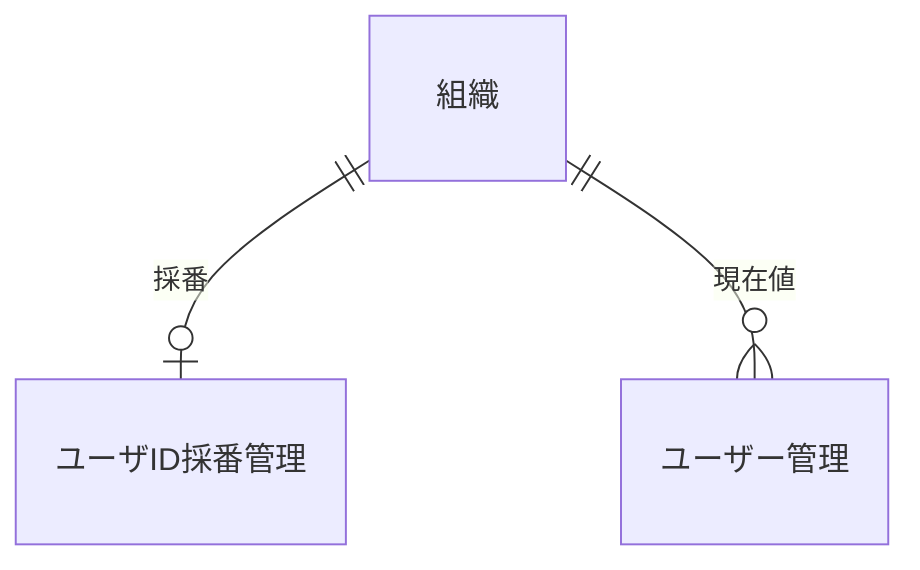
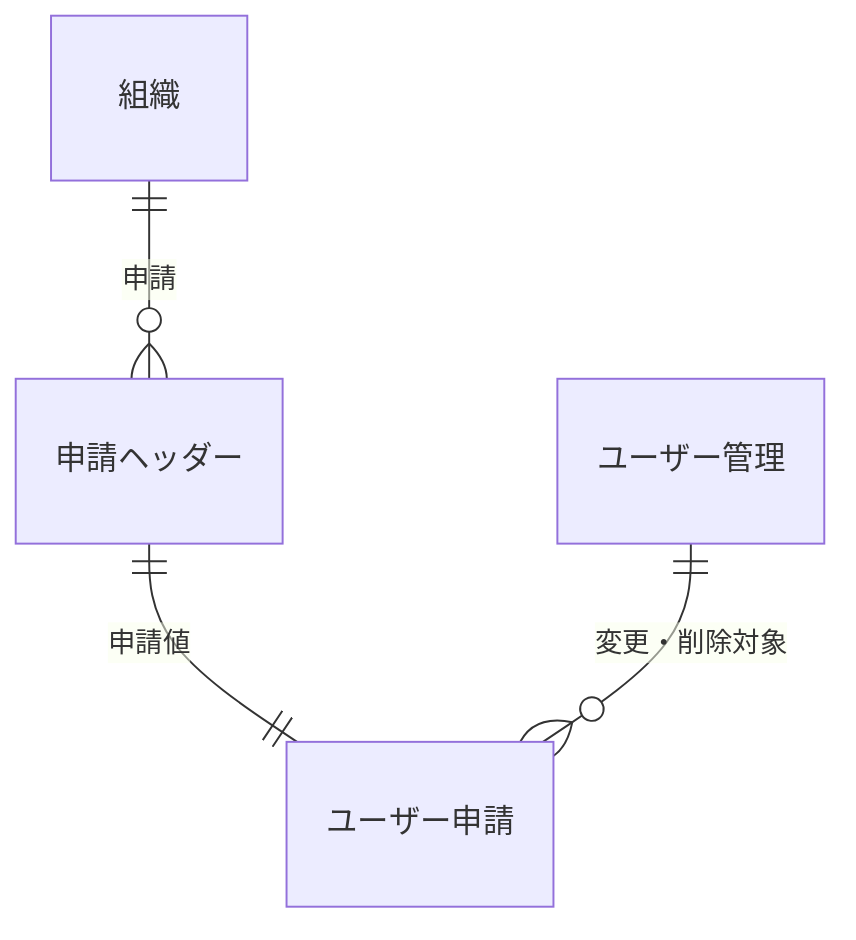

# DB設計 分割版 ユーザアカウント設定データ構造

## 2026-10-27 追加項目のDB先行対応

2026-10-22顧客回答に基づき、ユーザー現在値・申請値に、任意のユーザ識別情報（50文字以内、文字種制限なし）、タグ編集権限・データ非公開設定権限（1＝あり／0＝なし）を追加する。組織管理権限は2026-11-02の確定回答に基づき、画面・API・運用管理DBの現在値／申請値から削除する。新項目は請求対象項目へ追加しない。

現行アプリとの互換用デフォルトはフラグ0、識別情報は空文字。ユーザ識別情報は画面・APIに対応済み。タグ編集権限も画面・APIで現在値と申請値を引き継ぐ。データ非公開設定権限も画面・APIに対応済み。初期値の根拠・段階対応の制約は[物理設計](./90_テーブル物理設計.md)を参照する。

## 更新履歴

| 更新日 | 更新内容 | 更新理由 |
| --- | --- | --- |
| 2026-10-16 | 所属・閲覧グループを既存APIによる即時反映へ変更し、関連する保存先・参照関係を改訂。 請求根拠の所属名取得手段をAPIに限定する記述を除去。 | 予約申請方式を廃止するため。 |
| 2026-10-06 | 所属・閲覧グループの選択元と削除申請との相互制御を反映した。 | 所属・閲覧グループ管理の追加と本セッションの合意事項を設計一式へ反映するため。 |
| 2026-08-18 | 閲覧グループの選択範囲と識別方法を確定仕様へ更新した。 | プリセット閲覧グループと対象組織のカスタム閲覧グループを選択対象とし、種別とIDの複合値で識別することが確定したため。 |

## 目的

ユーザアカウント設定管理領域のデータ構造を整理する。

本資料では、voice value 利用アカウントの現在値、申請値、キー、申請種別、制限判定、適用時の反映、想定クエリを扱う。

---

## ユーザアカウント設定で扱う範囲

本資料で扱うユーザアカウント設定は、voice value 利用アカウントのみである。

以下は本資料の対象外とする。

```text
顧客管理者が管理サイトにログインするためのアカウント
SYNVOICE社内運用アカウント
```

ユーザアカウント設定は、1アカウントごとに申請する管理領域である。

```text
申請単位:
  1アカウントごと

適用日:
  1アカウントごとに1つ

未適用申請:
  1ユーザにつき1件まで
```

---

## 申請種別

ユーザアカウント設定では、申請データに申請種別を持たせる。

申請種別は、申請内容を変更する操作ではなく、適用時にユーザアカウントへ行う処理を表す。

```text
申請種別:
  作成
  変更
  削除

申請内容の変更:
  未適用申請の中身を修正する操作
```

| 申請種別 | 内容 | 適用成功時の扱い |
| --- | --- | --- |
| 作成 | 新規ユーザを作成する | 現在値としてユーザを作成し、申請データを削除する |
| 変更 | 既存ユーザの設定を変更する | 現在値を申請値で更新し、申請データを削除する |
| 削除 | 既存ユーザを削除する | 現在値を物理削除し、申請データを削除する |

削除申請は状態ではなく、申請種別として扱う。

これにより、申請データの有無と適用日で申請状態を判定する共通方針を維持する。

---

## ユーザIDと内部主キーの扱い

ユーザIDは、voice value 利用アカウントを既存システム上で識別する業務キーである。

運用管理システム内部の主キーとは分けて扱う。

```text
ユーザID
  既存システムへのログインID
  既存システムとの突合キー
  組織内で一意
  組織ID + 8桁連番で構成する
  作成申請保存時に自動採番する
  変更・削除時は変更不可
  ユーザアカウント設定の申請単位キーとして使う

ユーザー管理主キー
  運用管理システム内部の現在値主キー
  顧客は入力しない
  既存システム突合には使わない
  作成適用時にDBで採番する
```

ユーザIDの採番は、既存システム側のルールに合わせ、組織IDに8桁ゼロ埋め連番を結合した値とする。

```text
例:
  組織ID = SYNV
  採番値 = 1
  ユーザID = SYNV00000001
```

採番値はユーザID文字列そのものではなく、組織ごとの数値として管理する。

作成申請保存時は、対象組織の採番管理をロックし、申請内の新規ユーザー件数分の採番範囲を予約したうえで、`組織ID + LPAD(採番値, 8, '0')` 相当のユーザIDを生成する。

生成したユーザIDは、申請ヘッダーの申請単位キーとユーザー申請のユーザIDに保存する。

採番管理は作成申請保存時点で進める。作成申請を取消した場合や、作成申請の適用が失敗した場合でも、予約済み番号は再利用しない。

ユーザIDを変更したい場合は、既存ユーザを削除し、削除適用後に新しいユーザIDで作成申請する。

削除は物理削除とするが、削除後も同一組織内で同じユーザIDは再利用しない。

削除済みユーザIDの再利用は、現在値とは別に保持する組織単位の採番管理により防止する。

採番管理は、過去に発行したユーザID文字列をすべて保持する台帳ではなく、組織ごとの最終発行番号または次回発行番号を保持する構造とする。

採番管理の行は組織発行時に作成し、最終発行番号を `0` で初期化する。組織作成後にユーザー作成申請を行う前提のため、ユーザー作成申請側で採番管理行を作成する流れにはしない。

連番は8桁固定とする。1組織内で1億件以上の発行は運用上発生しない前提とし、上限到達時は業務上の異常として扱う。

---

## 現在値の構造



キー構造は以下とする。

```text
ユーザー管理
  ユーザー管理主キー
  組織ID
  ユーザID

ユーザID採番管理
  組織ID
  最終発行番号
```

制約の考え方:

```text
主キー:
  ユーザー管理主キー

業務一意:
  組織ID + ユーザID

ユーザID採番管理:
  組織IDごとに1件
```

---

## 現在値の論理テーブル構造

本章では、想定クエリで使用する範囲の論理項目だけを記載する。

作成日時、更新日時、作成者、更新者、監査項目などの詳細設計項目はここでは扱わない。

### ユーザー管理

| 論理項目 | 説明 |
| --- | --- |
| ユーザー管理主キー | ユーザー管理現在値を一意に識別する内部主キー |
| 組織ID | ユーザが所属する組織 |
| ユーザID | 自動採番するユーザID。既存システムログインID、突合キー |
| ユーザ名 | ユーザ名 |
| ユーザ識別情報 | 任意文字列。文字種制限なし、50文字以内。未入力は空文字 |
| メールアドレス | 認証IDとして使用するメールアドレス |
| パスワードハッシュ | voice value 利用アカウントのパスワードハッシュ |
| 所属コード | 所属を識別するコード |
| 閲覧グループ種別 | プリセットまたはカスタムを識別する区分 |
| 閲覧グループID | 種別に対応する閲覧グループID |
| 録音権限 | 録音可能ユーザ、閲覧専用ユーザの区分 |
| 管理権限 | 管理権限 |
| CSVダウンロード権限 | CSVダウンロード可否 |
| タグ編集権限 | タグ編集の可否。1：あり／0：なし |
| 1か月の録音可能時間 | 各ユーザに設定する録音時間プラン |
| データ非公開設定権限 | データ非公開設定の可否。1：あり／0：なし |
| 追加認証設定 | ユーザ単位の二要素認証設定 |
| 請求項目最終変更適用日 | 請求項目を最後に変更した申請の適用日 |
| アカウント作成適用日 | ユーザ作成申請が適用された日 |

パスワードは、voice value 利用アカウントの既存システム向け設定値であり、運用管理システムへログインするための認証情報ではない。

運用管理システムでは、既存システムへの申し送り値として扱う。

パスワード関連値を扱う場合でも、平文パスワードは保持しない。

ユーザー管理およびユーザー申請には、ソルトなし SHA-256 ハッシュ値を保持する。

CSV出力、ログ、エラーファイルには平文パスワードを出力しない。

管理者によるパスワード変更を行う場合も、保存時点でハッシュ化した値だけを申請値として保持する。

---

## 申請値の構造

申請値側は、申請ヘッダーにひもづく。



申請値側の構造は以下とする。

```text
申請ヘッダー
  申請ID
  管理領域 = ユーザアカウント設定
  申請単位キー = ユーザID
  適用日

ユーザー申請
  申請ID
  申請種別
  ユーザー管理主キー
  ユーザID
```

ユーザアカウント設定では、申請単位キーにユーザIDを設定する。

これにより、申請ヘッダーの一意制約で、同一組織・同一ユーザIDの未適用申請を1件に制限できる。

```text
一意制約:
  組織ID + 管理領域 + 申請単位キー

ユーザアカウント設定の場合:
  組織ID + ユーザアカウント設定 + ユーザID
```

---

## 申請値の論理テーブル構造

### ユーザー申請

| 論理項目 | 説明 |
| --- | --- |
| 申請ID | 親となる申請ヘッダー |
| 申請種別 | 作成、変更、削除 |
| ユーザー管理主キー | 変更・削除対象の現在値内部主キー。作成申請では未設定 |
| ユーザID | 自動採番するユーザID。申請単位キーと同じ値 |
| ユーザ名 | 申請後に適用したいユーザ名 |
| ユーザ識別情報 | 任意文字列。文字種制限なし、50文字以内。未入力は空文字 |
| メールアドレス | 申請後に適用したいメールアドレス |
| パスワードハッシュ | 申請後に適用したいパスワードハッシュ |
| 所属コード | 申請後に適用したい所属コード |
| 閲覧グループ種別 | 申請後に適用したいプリセットまたはカスタムの区分 |
| 閲覧グループID | 申請後に適用したい閲覧グループID |
| 録音権限 | 申請後に適用したい録音権限 |
| 管理権限 | 申請後に適用したい管理権限 |
| CSVダウンロード権限 | 申請後に適用したいCSVダウンロード権限 |
| タグ編集権限 | タグ編集の可否。1：あり／0：なし |
| 1か月の録音可能時間 | 申請後に適用したい録音時間プラン |
| データ非公開設定権限 | データ非公開設定の可否。1：あり／0：なし |
| 追加認証設定 | 申請後に適用したい追加認証設定 |
| 請求項目最終変更適用日 | 申請適用後の請求項目最終変更適用日 |

ユーザIDは、作成申請保存時に自動採番する。

変更申請、削除申請では現在値からコピーし、変更不可とする。

---

## 申請種別ごとのデータ作成方針

### 作成申請

作成申請では、画面入力またはCSV取り込みにより、作成したいユーザ情報を申請値として持つ。

ユーザIDは画面入力値ではなく、作成申請保存時に組織内で未使用の値を自動採番する。

作成申請はCSV取り込みなどで複数ユーザー分を一括保存する場合がある。その場合は、対象組織の採番管理を1回ロックし、一括申請内の新規ユーザー件数分の連番範囲を先に予約してから、各ユーザー申請へユーザIDを割り当てる。

```text
申請ヘッダー.申請単位キー
  自動採番したユーザID

ユーザー申請.申請種別
  作成

ユーザー申請.ユーザー管理主キー
  未設定

ユーザー申請.ユーザID
  自動採番したユーザID
```

保存時は、組織単位の採番管理からユーザIDを生成する。

採番管理の更新により過去発行済み番号の再利用を防ぎ、生成後の安全確認として、現在値のユーザID、未適用申請のユーザIDと重複しないことを確認する。

### 変更申請

変更申請では、現在値を申請値へコピーし、変更後の内容を申請値として持つ。

```text
申請ヘッダー.申請単位キー
  既存ユーザID

ユーザー申請.申請種別
  変更

ユーザー申請.ユーザー管理主キー
  既存現在値のユーザー管理主キー

ユーザー申請.ユーザID
  既存ユーザID
```

ユーザIDは変更不可とする。

### 削除申請

削除申請では、削除対象ユーザの現在値を申請値へコピーする。

申請値は、削除対象を確認するためのスナップショットとして扱う。

```text
申請ヘッダー.申請単位キー
  既存ユーザID

ユーザー申請.申請種別
  削除

ユーザー申請.ユーザー管理主キー
  既存現在値のユーザー管理主キー

ユーザー申請.ユーザID
  既存ユーザID
```

適用時は、対象の現在値を物理削除する。

---

## 請求項目最終変更適用日の扱い

請求項目最終変更適用日は、請求項目の1か月制限を判定するための管理項目である。

請求項目は以下とする。

```text
録音権限
1か月の録音可能時間
```

申請データには、画面入力項目ではなく内部項目として請求項目最終変更適用日を持つ。

特別な状態項目や変更有無フラグは持たせない。

申請作成・申請変更時に、現在値と入力値を比較して請求項目最終変更適用日を再計算し、申請値に混ぜ込む。

```text
請求項目に変更なし:
  申請値.請求項目最終変更適用日
    = 現在値.請求項目最終変更適用日

請求項目に変更あり:
  申請値.請求項目最終変更適用日
    = 申請ヘッダー.適用日
```

適用時は、他項目と同じく申請値を現在値へ反映する。

```text
ユーザー管理.請求項目最終変更適用日
  = ユーザー申請.請求項目最終変更適用日
```

作成申請では現在値がないため、請求項目最終変更適用日は申請ヘッダーの適用日とする。

削除申請では現在値を物理削除するため、適用後は使用しない。

---

## アカウント作成適用日の扱い

アカウント作成適用日は、ユーザアカウントの作成完了後1か月制限を判定するための管理項目である。

作成申請の適用時に、申請ヘッダーの適用日を現在値へ反映する。

```text
ユーザー管理.アカウント作成適用日
  = 申請ヘッダー.適用日
```

変更申請では更新しない。

削除申請では、ユーザー管理現在値のアカウント作成適用日を参照して、削除申請を作成できるか判定する。

---

## 申請変更時のデータ更新

ユーザー申請は1申請につき1件である。

申請変更時は、申請ヘッダーをロックし、現在値と入力値をもとにユーザー申請を更新する。

```text
申請変更:
  申請ヘッダーをロック
  現在値を取得
  入力値と比較
  請求項目最終変更適用日を再計算
  ユーザー申請を更新
  必要に応じて申請ヘッダーの適用日を更新
```

申請種別そのものは、申請内容の変更操作では変えない。

申請をやめる場合は、申請取消として申請データを削除する。

---

## 適用時の反映

ユーザアカウント設定は、申請種別によって現在値への反映方法が異なる。

運用管理システム側では、既存システム側の反映成功後、申請種別に応じて以下を実行する。

```text
作成:
  ユーザー管理にINSERT
  ユーザー申請を削除
  申請ヘッダーを削除

変更:
  ユーザー管理をUPDATE
  ユーザー申請を削除
  申請ヘッダーを削除

削除:
  ユーザー管理をDELETE
  ユーザー申請を削除
  申請ヘッダーを削除
```

削除後も同一組織内で同じユーザIDは再利用しない。

過去の請求根拠明細は、請求確定時点の情報として独立保持するため、現在値とは突合しない。

---

## 請求根拠明細との関係

ユーザアカウント設定では、以下が請求根拠として保持・出力される。

```text
ユーザID
ユーザ名
所属コード
録音権限
1か月の録音可能時間
```

請求根拠明細は、請求確定時点の請求情報としてクローズする。

ユーザー管理現在値と後から突合して再構成しない。

そのため、削除済みユーザの影響を受けない。

所属名は、請求根拠明細作成時に所属コードから取得される想定であり、ユーザー管理現在値では所属コードを保持する。

---

## 閲覧グループの確定仕様

ユーザアカウント設定の所属・閲覧グループは、以下の範囲で扱う。

```text
所属・閲覧グループの選択範囲
  所属は既存APIで対象組織の登録済み所属を取得する。
  所属・カスタムグループは登録完了後すぐに選択できる。所属・グループ自体の予約申請は行わない。
  閲覧グループは、種別とIDの複合値で識別する。
  プリセット閲覧グループと対象組織のカスタム閲覧グループの両方を選択対象とする。
```

---

ユーザーの現在値・未適用申請値で参照される所属・グループは削除不可とする。削除APIを呼ぶ前に運用管理側で参照を確認する。ユーザー申請保存時も対象組織・存在を検証する。詳細は `42_所属・閲覧グループ管理.md` を参照する。

## 想定クエリ

本章のSQLは、データ構造の妥当性を確認するための擬似SQLである。

物理名ではなく、設計上の論理名で記載する。

### ある組織の現在ユーザ一覧を取得する

```sql
SELECT
    ユーザー管理.ユーザー管理主キー,
    ユーザー管理.組織ID,
    ユーザー管理.ユーザID,
    ユーザー管理.ユーザ名,
    ユーザー管理.ユーザ識別情報,
    ユーザー管理.所属コード,
    ユーザー管理.閲覧グループ種別,
    ユーザー管理.閲覧グループID,
    ユーザー管理.録音権限,
    ユーザー管理.管理権限,
    ユーザー管理.CSVダウンロード権限,
    ユーザー管理.タグ編集権限,
    ユーザー管理.1か月の録音可能時間,
    ユーザー管理.データ非公開設定権限,
    ユーザー管理.追加認証設定,
    ユーザー管理.請求項目最終変更適用日,
    ユーザー管理.アカウント作成適用日
FROM
    ユーザー管理
WHERE
    ユーザー管理.組織ID = :組織ID
ORDER BY
    ユーザー管理.ユーザID;
```

### ある申請IDのユーザー申請を取得する

```sql
SELECT
    申請ヘッダー.申請ID,
    申請ヘッダー.組織ID,
    申請ヘッダー.申請単位キー,
    申請ヘッダー.適用日,
    ユーザー申請.申請種別,
    ユーザー申請.ユーザー管理主キー,
    ユーザー申請.ユーザID,
    ユーザー申請.ユーザ名,
    ユーザー申請.ユーザ識別情報,
    ユーザー申請.メールアドレス,
    ユーザー申請.パスワードハッシュ,
    ユーザー申請.所属コード,
    ユーザー申請.閲覧グループ種別,
    ユーザー申請.閲覧グループID,
    ユーザー申請.録音権限,
    ユーザー申請.管理権限,
    ユーザー申請.CSVダウンロード権限,
    ユーザー申請.タグ編集権限,
    ユーザー申請.1か月の録音可能時間,
    ユーザー申請.データ非公開設定権限,
    ユーザー申請.追加認証設定,
    ユーザー申請.請求項目最終変更適用日
FROM
    申請ヘッダー
    INNER JOIN ユーザー申請
        ON ユーザー申請.申請ID = 申請ヘッダー.申請ID
WHERE
    申請ヘッダー.申請ID = :申請ID;
```

### 作成申請保存時にユーザIDを予約する

作成申請保存時に、対象組織の採番管理をロックして、一括申請内の新規ユーザー件数分の採番範囲を予約する。

採番管理は組織ごとの数値を保持し、ユーザID文字列は `組織ID + LPAD(採番値, 8, '0')` 相当で生成する。

```sql
SELECT
    ユーザID採番管理.最終発行番号
FROM
    ユーザID採番管理
WHERE
    ユーザID採番管理.組織ID = :組織ID
FOR UPDATE;
```

```sql
-- 採番管理は組織発行時に 最終発行番号 = 0 で作成済みとする。
-- 存在しない場合は、組織発行処理または移行データの不整合として扱う。
```

```sql
SET :新規ユーザー件数 = :作成申請内の新規ユーザー件数;
SET :開始採番値 = ユーザID採番管理.最終発行番号 + 1;
SET :終了採番値 = ユーザID採番管理.最終発行番号 + :新規ユーザー件数;

UPDATE
    ユーザID採番管理
SET
    最終発行番号 = :終了採番値
WHERE
    組織ID = :組織ID;
```

申請内の各新規ユーザーには、`:開始採番値` から `:終了採番値` までを順に割り当て、`CONCAT(:組織ID, LPAD(:採番値, 8, '0'))` でユーザIDを生成する。

採番管理を更新した時点で番号は予約済みとする。

作成申請を取消した場合、または作成申請の適用が失敗した場合でも、採番値は戻さない。

そのため、採番後の重複確認は通常発生しない想定だが、既存データ移行や手動補正に備え、生成したユーザIDが同一組織内の現在値・未適用申請と重複していないことを確認する。

```sql
SELECT
    ユーザー管理.ユーザー管理主キー
FROM
    ユーザー管理
WHERE
    ユーザー管理.組織ID = :組織ID
    AND ユーザー管理.ユーザID = :ユーザID;
```

```sql
SELECT
    申請ヘッダー.申請ID
FROM
    申請ヘッダー
WHERE
    申請ヘッダー.組織ID = :組織ID
    AND 申請ヘッダー.管理領域 = 'ユーザアカウント設定'
    AND 申請ヘッダー.申請単位キー = :ユーザID;
```

### 作成申請を作成する

```sql
BEGIN;

INSERT INTO 申請ヘッダー (
    組織ID,
    管理領域,
    申請単位キー,
    適用日
)
VALUES (
    :組織ID,
    'ユーザアカウント設定',
    :ユーザID,
    :適用日
);

INSERT INTO ユーザー申請 (
    申請ID,
    申請種別,
    ユーザー管理主キー,
    ユーザID,
    ユーザ名,
    ユーザ識別情報,
    メールアドレス,
    パスワードハッシュ,
    所属コード,
    閲覧グループ種別,
    閲覧グループID,
    録音権限,
    管理権限,
    CSVダウンロード権限,
    タグ編集権限,
    1か月の録音可能時間,
    データ非公開設定権限,
    追加認証設定,
    請求項目最終変更適用日
)
VALUES (
    :申請ID,
    '作成',
    NULL,
    :ユーザID,
    :ユーザ名,
    :ユーザ識別情報,
    :メールアドレス,
    SHA2(:平文パスワード, 256),
    :所属コード,
    :閲覧グループ種別,
    :閲覧グループID,
    :録音権限,
    :管理権限,
    :CSVダウンロード権限,
    :タグ編集権限,
    :1か月の録音可能時間,
    :データ非公開設定権限,
    :追加認証設定,
    :適用日
);

COMMIT;
```

### 変更申請を作成する

現在値を申請値へコピーし、変更後の入力値で上書きする。

請求項目最終変更適用日は、現在値と入力値を比較して決定する。

```sql
INSERT INTO 申請ヘッダー (
    組織ID,
    管理領域,
    申請単位キー,
    適用日
)
VALUES (
    :組織ID,
    'ユーザアカウント設定',
    :ユーザID,
    :適用日
);
```

```sql
INSERT INTO ユーザー申請 (
    申請ID,
    申請種別,
    ユーザー管理主キー,
    ユーザID,
    ユーザ名,
    ユーザ識別情報,
    メールアドレス,
    パスワードハッシュ,
    所属コード,
    閲覧グループ種別,
    閲覧グループID,
    録音権限,
    管理権限,
    CSVダウンロード権限,
    タグ編集権限,
    1か月の録音可能時間,
    データ非公開設定権限,
    追加認証設定,
    請求項目最終変更適用日
)
SELECT
    :申請ID,
    '変更',
    ユーザー管理.ユーザー管理主キー,
    ユーザー管理.ユーザID,
    :ユーザ名,
    :ユーザ識別情報,
    :メールアドレス,
    CASE
        WHEN :平文パスワード IS NOT NULL
        THEN SHA2(:平文パスワード, 256)
        ELSE ユーザー管理.パスワードハッシュ
    END,
    :所属コード,
    :閲覧グループ種別,
    :閲覧グループID,
    :録音権限,
    :管理権限,
    :CSVダウンロード権限,
    :タグ編集権限,
    :1か月の録音可能時間,
    :データ非公開設定権限,
    :追加認証設定,
    CASE
        WHEN ユーザー管理.録音権限 <> :録音権限
          OR ユーザー管理.1か月の録音可能時間 <> :1か月の録音可能時間
        THEN :適用日
        ELSE ユーザー管理.請求項目最終変更適用日
    END
FROM
    ユーザー管理
WHERE
    ユーザー管理.組織ID = :組織ID
    AND ユーザー管理.ユーザID = :ユーザID;
```

### 削除申請を作成する

削除対象ユーザの現在値を申請値へコピーする。

作成完了後1か月経過前の削除申請はできない。

この判定は、現在値のアカウント作成適用日を参照して行う。

```sql
SELECT
    ユーザー管理.ユーザー管理主キー
FROM
    ユーザー管理
WHERE
    ユーザー管理.組織ID = :組織ID
    AND ユーザー管理.ユーザID = :ユーザID
    AND ユーザー管理.アカウント作成適用日 <= :判定日 - INTERVAL 1 MONTH;
```

`:判定日` は、申請作成時または画面制御時の判定基準日を表す。

削除可能なユーザであることを確認したうえで、削除申請を作成する。

```sql
INSERT INTO 申請ヘッダー (
    組織ID,
    管理領域,
    申請単位キー,
    適用日
)
VALUES (
    :組織ID,
    'ユーザアカウント設定',
    :ユーザID,
    :適用日
);
```

```sql
INSERT INTO ユーザー申請 (
    申請ID,
    申請種別,
    ユーザー管理主キー,
    ユーザID,
    ユーザ名,
    ユーザ識別情報,
    メールアドレス,
    パスワードハッシュ,
    所属コード,
    閲覧グループ種別,
    閲覧グループID,
    録音権限,
    管理権限,
    CSVダウンロード権限,
    タグ編集権限,
    1か月の録音可能時間,
    データ非公開設定権限,
    追加認証設定,
    請求項目最終変更適用日
)
SELECT
    :申請ID,
    '削除',
    ユーザー管理.ユーザー管理主キー,
    ユーザー管理.ユーザID,
    ユーザー管理.ユーザ名,
    ユーザー管理.ユーザ識別情報,
    ユーザー管理.メールアドレス,
    ユーザー管理.パスワードハッシュ,
    ユーザー管理.所属コード,
    ユーザー管理.閲覧グループ種別,
    ユーザー管理.閲覧グループID,
    ユーザー管理.録音権限,
    ユーザー管理.管理権限,
    ユーザー管理.CSVダウンロード権限,
    ユーザー管理.タグ編集権限,
    ユーザー管理.1か月の録音可能時間,
    ユーザー管理.データ非公開設定権限,
    ユーザー管理.追加認証設定,
    ユーザー管理.請求項目最終変更適用日
FROM
    ユーザー管理
WHERE
    ユーザー管理.組織ID = :組織ID
    AND ユーザー管理.ユーザID = :ユーザID;
```

### 申請変更時にユーザー申請を更新する

申請ヘッダーをロックしたうえで、申請値を更新する。

請求項目最終変更適用日は、現在値と入力値から再計算する。

```sql
SELECT
    申請ID
FROM
    申請ヘッダー
WHERE
    申請ID = :申請ID
FOR UPDATE;

UPDATE ユーザー申請
    INNER JOIN 申請ヘッダー
        ON 申請ヘッダー.申請ID = ユーザー申請.申請ID
    LEFT JOIN ユーザー管理
        ON ユーザー管理.組織ID = 申請ヘッダー.組織ID
       AND ユーザー管理.ユーザID = ユーザー申請.ユーザID
SET
    ユーザー申請.ユーザ名 = :ユーザ名,
    ユーザー申請.ユーザ識別情報 = :ユーザ識別情報,
    ユーザー申請.メールアドレス = :メールアドレス,
    ユーザー申請.パスワードハッシュ =
        CASE
            WHEN :平文パスワード IS NOT NULL
            THEN SHA2(:平文パスワード, 256)
            ELSE ユーザー申請.パスワードハッシュ
        END,
    ユーザー申請.所属コード = :所属コード,
    ユーザー申請.閲覧グループ種別 = :閲覧グループ種別,
    ユーザー申請.閲覧グループID = :閲覧グループID,
    ユーザー申請.録音権限 = :録音権限,
    ユーザー申請.管理権限 = :管理権限,
    ユーザー申請.CSVダウンロード権限 = :CSVダウンロード権限,
    ユーザー申請.タグ編集権限 = :タグ編集権限,
    ユーザー申請.1か月の録音可能時間 = :1か月の録音可能時間,
    ユーザー申請.データ非公開設定権限 = :データ非公開設定権限,
    ユーザー申請.追加認証設定 = :追加認証設定,
    ユーザー申請.請求項目最終変更適用日 =
        CASE
            WHEN ユーザー申請.申請種別 = '作成'
            THEN 申請ヘッダー.適用日
            WHEN ユーザー管理.録音権限 <> :録音権限
              OR ユーザー管理.1か月の録音可能時間 <> :1か月の録音可能時間
            THEN 申請ヘッダー.適用日
            ELSE ユーザー管理.請求項目最終変更適用日
        END
WHERE
    ユーザー申請.申請ID = :申請ID;
```

### 適用時に作成申請を現在値へ反映する

以下の作成、変更、削除のいずれかの現在値反映と、申請データ削除は同一トランザクションで実行する。

```sql
BEGIN;

SELECT
    申請ID
FROM
    申請ヘッダー
WHERE
    申請ID = :申請ID
FOR UPDATE;

SELECT
    ユーザー管理.ユーザー管理主キー
FROM
    ユーザー管理
    INNER JOIN ユーザー申請
        ON ユーザー申請.ユーザー管理主キー = ユーザー管理.ユーザー管理主キー
WHERE
    ユーザー申請.申請ID = :申請ID
    AND ユーザー申請.申請種別 IN ('変更', '削除')
FOR UPDATE;

INSERT INTO ユーザー管理 (
    組織ID,
    ユーザID,
    ユーザ名,
    ユーザ識別情報,
    メールアドレス,
    パスワードハッシュ,
    所属コード,
    閲覧グループ種別,
    閲覧グループID,
    録音権限,
    管理権限,
    CSVダウンロード権限,
    タグ編集権限,
    1か月の録音可能時間,
    データ非公開設定権限,
    追加認証設定,
    請求項目最終変更適用日,
    アカウント作成適用日
)
SELECT
    申請ヘッダー.組織ID,
    ユーザー申請.ユーザID,
    ユーザー申請.ユーザ名,
    ユーザー申請.ユーザ識別情報,
    ユーザー申請.メールアドレス,
    ユーザー申請.パスワードハッシュ,
    ユーザー申請.所属コード,
    ユーザー申請.閲覧グループ種別,
    ユーザー申請.閲覧グループID,
    ユーザー申請.録音権限,
    ユーザー申請.管理権限,
    ユーザー申請.CSVダウンロード権限,
    ユーザー申請.タグ編集権限,
    ユーザー申請.1か月の録音可能時間,
    ユーザー申請.データ非公開設定権限,
    ユーザー申請.追加認証設定,
    ユーザー申請.請求項目最終変更適用日,
    申請ヘッダー.適用日
FROM
    申請ヘッダー
    INNER JOIN ユーザー申請
        ON ユーザー申請.申請ID = 申請ヘッダー.申請ID
WHERE
    申請ヘッダー.申請ID = :申請ID
    AND ユーザー申請.申請種別 = '作成';
```

### 適用時に変更申請を現在値へ反映する

```sql
UPDATE ユーザー管理
    INNER JOIN ユーザー申請
        ON ユーザー申請.ユーザー管理主キー = ユーザー管理.ユーザー管理主キー
SET
    ユーザー管理.ユーザ名 = ユーザー申請.ユーザ名,
    ユーザー管理.ユーザ識別情報 = ユーザー申請.ユーザ識別情報,
    ユーザー管理.メールアドレス = ユーザー申請.メールアドレス,
    ユーザー管理.パスワードハッシュ = ユーザー申請.パスワードハッシュ,
    ユーザー管理.所属コード = ユーザー申請.所属コード,
    ユーザー管理.閲覧グループ種別 = ユーザー申請.閲覧グループ種別,
    ユーザー管理.閲覧グループID = ユーザー申請.閲覧グループID,
    ユーザー管理.録音権限 = ユーザー申請.録音権限,
    ユーザー管理.管理権限 = ユーザー申請.管理権限,
    ユーザー管理.CSVダウンロード権限 = ユーザー申請.CSVダウンロード権限,
    ユーザー管理.タグ編集権限 = ユーザー申請.タグ編集権限,
    ユーザー管理.1か月の録音可能時間 = ユーザー申請.1か月の録音可能時間,
    ユーザー管理.データ非公開設定権限 = ユーザー申請.データ非公開設定権限,
    ユーザー管理.追加認証設定 = ユーザー申請.追加認証設定,
    ユーザー管理.請求項目最終変更適用日 = ユーザー申請.請求項目最終変更適用日
WHERE
    ユーザー申請.申請ID = :申請ID
    AND ユーザー申請.申請種別 = '変更';
```

### 適用時に削除申請を現在値へ反映する

ユーザー申請はユーザー管理を参照するため、外部キー制約がある物理DBでは、削除対象のユーザー管理主キーを保持したうえで、申請データを先に削除してから現在値を物理削除する。

```sql
SELECT
    ユーザー申請.ユーザー管理主キー
INTO
    :削除対象ユーザー管理主キー
FROM
    ユーザー申請
WHERE
    ユーザー申請.申請ID = :申請ID
    AND ユーザー申請.申請種別 = '削除'
FOR UPDATE;

DELETE FROM ユーザー申請
WHERE
    申請ID = :申請ID;

DELETE FROM ユーザー管理
WHERE
    ユーザー管理主キー = :削除対象ユーザー管理主キー;
```

### 適用後に申請データを削除する

削除申請では、現在値削除前にユーザー申請を削除済みのため、適用後は申請ヘッダーのみ削除する。

```sql
DELETE FROM 申請ヘッダー
WHERE
    申請ID = :申請ID;

COMMIT;
```

### 請求根拠明細作成時にユーザ情報を取得する

請求構造の詳細は請求データ設計で検討する。

ここでは、ユーザアカウント設定が請求根拠明細へ提供するユーザ属性だけを確認する。

```sql
SELECT
    ユーザー管理.組織ID,
    ユーザー管理.ユーザID,
    ユーザー管理.ユーザ名,
    ユーザー管理.所属コード,
    -- 所属名は請求根拠作成時点の既存所属と組織ID・所属コードで対応付ける。
    ユーザー管理.録音権限,
    ユーザー管理.1か月の録音可能時間
FROM
    ユーザー管理
WHERE
    ユーザー管理.組織ID = :組織ID;
```

所属名の参照元は既存所属（`meetingscan_web.tm_division`）であり、組織ID・所属コードで対応付ける。請求根拠作成は既存側バッチの担当範囲であり、本書ではDB参照・API利用等の具体的な取得手段を指定しない。運用管理システムは作成済みのスナップショットを参照する。
