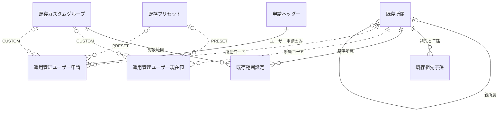

# DB設計 分割版 所属・閲覧グループ管理データ構造

> 現行運用（2026-10-28 利用者判断）：連携先で組織を先に登録し、同じ組織IDで運用管理へ登録する。初期所属の確認・作成を組織登録の成功条件とする。一時停止は撤回。所属一覧APIの汎用検証エラーでは組織未登録と断定せず、連携先の登録状態と入力IDの確認を案内する。通信障害は別エラーとする。


## 変更履歴

| 変更日 | 変更内容 | 変更理由 |
| --- | --- | --- |
| 2026-10-22 | システム専用所属の判定をis_systemに統一し、既存の非表示明細の保持を明記。 | 顧客回答とコード名に依存しない除外方針を反映するため。 |
| 2026-10-21 | プリセット説明文のAPI参照と、組織登録時の初期所属確認・作成・再利用を整理。 | 提供API仕様と現行実装に合わせるため。 |
| 2026-10-16 | 即時反映・既存API参照へ変更し、ローカル7テーブルと申請・バッチ処理を廃止。部分ERと参照確認SQLを改訂。 プリセットのAPI取得項目と画面側の説明文を区別。直接DBアクセス・スキーマ設定の廃止とアプリ用DB権限を外す条件を追加。 | 所属・閲覧グループを登録直後から利用可能にするため。 |
| 2026-10-15 | 一括申請・ユーザー参照制約・採番・初期状態の確定状況と、サポート所属の予約コード・移動補正の確認状況を整理。 | 10月13日の顧客回答とソース調査結果を反映するため。 |
| 2026-10-09 | 所属移動時の閲覧範囲明細の自動補正方針を反映。 | 2026-10-09の合意に合わせるため。 |
| 2026-10-07 | 申請内キーの採番・共通参照、既存DBの反映先4テーブル、組織単位の反映と顧客確認2件を明記した。 | テーブルごとのレビュー結果を反映するため。 |
| 2026-10-06 | 論理構造・部分ER・擬似SQLを他の分割設計書と同じ形式で整理し、物理定義を90へ記載した。 | 所属・閲覧グループ管理の追加をDB設計一式に反映するため。 |

## 目的

所属・閲覧グループの既存データ構造、APIによる即時反映、ユーザーアカウント申請との参照関係を定義する。物理定義の扱いは `90_テーブル物理設計.md`、全体の関連は `00_全体ER図.md` を参照する。

## 管理方式と保存先

所属とカスタム閲覧グループは、それぞれの保存操作で既存MeetingScan APIを呼び、即時反映する。データの保存先は `meetingscan_web` とし、運用管理DBに現在値の複製・申請テーブル・プリセットのコピーを作成しない。本機能では申請ヘッダー、適用日、申請内キー、日次バッチによる反映を使用しない。

運用管理バックエンドが `/sysapp/api/` を呼び出す。既存DBへの直接更新SQLは実装しない。API成功後に一覧・詳細を再取得し、登録結果を表示する。ユーザーアカウント自体の予約申請方式は維持する。

### MeetingScanスキーマへの直接アクセスの廃止

運用管理アプリから `meetingscan_web` への直接DBアクセスを廃止し、所属・閲覧グループの参照・存在確認・更新は既存APIを使用する。ユーザーアカウント申請の選択肢取得と保存時検証も対象に含む。

既存実装からの切替対象は以下とする。

| 切替対象 | 対応 |
| --- | --- |
| 所属候補の直接参照SQL | 既存の所属一覧APIを使用する |
| プリセット・カスタムグループ候補の直接参照SQL | 既存の閲覧グループ一覧APIを使用する |
| ユーザー申請保存時の所属・グループ存在確認SQL | 既存APIから取得した情報で対象組織・存在・種別を検証する。録音時間等の運用管理DB内の検証は維持する |
| 起動時のMeetingScanスキーマ参照可否チェック | 廃止する |
| `MEETING_SCAN_SCHEMA_NAME` 設定とスキーマ名の引き渡し | 廃止し、MeetingScan APIの接続先設定へ切り替える |

直接参照の置換が完了し、MeetingScanスキーマへのDB権限なしでアプリの起動、候補取得、ユーザー申請保存時の検証、所属・グループの操作が動作することを確認した後、運用管理アプリ用DBユーザーの当該スキーマへのアクセス権を外す。API通信失敗時に直接DB参照へ戻す経路は設けない。

権限を外す対象は運用管理アプリ用DBユーザーである。既存MeetingScan APIと日次バッチが使用するDBアクセス権は維持する。請求CSVは請求根拠に保存済みの所属名を出力し、運用管理アプリがMeetingScanスキーマから所属名を直接取得する必要はない。実環境の権限変更は顧客側の環境設定として実施する。

## 既存データの論理構造

以下の5テーブルは既存MeetingScanのテーブルであり、運用管理DBの新設テーブルではない。

| 論理名 | 既存物理名（meetingscan_web） | 主な項目・役割 |
| --- | --- | --- |
| 所属 | tm_division | 組織ID、所属コード、名称、親所属コード、表示順、システム所属区分 |
| 所属の祖先・子孫 | tm_division_closure | 組織ID、祖先所属コード、子孫所属コード、階層の深さ |
| カスタム閲覧グループ | tm_custom_access_group | グループID、組織ID、名称 |
| 閲覧範囲設定 | tm_custom_access_group_scope | グループID、組織ID、所属コード、配下を含む、管理者を含む |
| プリセット閲覧グループ | tm_preset_access_group | プリセットID、名称、種別。共通定義を参照する |

### 所属と階層

所属は組織IDと所属コードで識別する。コードは変更せず、名称・親所属・表示順を既存APIで更新する。同じ組織内の親を参照し、最上位は親なしとする。親子関係と祖先・子孫テーブルの整合性、循環の検証は既存APIに従う。運用管理側で階層テーブルを再生成しない。

### 閲覧グループと対象所属

カスタム閲覧グループIDは既存DBのAUTO_INCREMENTで採番する。名称や対象範囲を変更しても既存IDを維持する。新規登録後はAPIから一覧を再取得する方式とし、登録レスポンスが採番IDを返すことを前提にしない。

閲覧範囲設定は、グループと基準所属を関連付ける。対象範囲は「この所属のみ／配下を含む」、管理者範囲は「管理者を除く／管理者を含む」で設定する。「配下を含む」の対象は既存階層から判定され、子孫ごとの明細作成を必要としない。

所属移動では既存APIの親子・祖先子孫更新を使用する。独自の範囲明細の自動補正・補完は行わない。移動で実際の閲覧対象が変わる場合も、既存APIの判定・保存動作に従う。

### プリセット

既存の一覧APIからID・名称・種別（`preset_type`）・説明文（`summary_text`）を取得し、カスタムと区別して表示する。説明文はAPIの値を表示し、空の場合も画面側で種別から補完しない。編集・削除を行わず、組織ごとの複製・割り当てテーブルや運用管理側のマスターコピーを設けない。

## 部分ER図

`既存` はMeetingScan側、`運用管理` は運用管理DBを表す。点線はアプリケーションで検証する論理参照であり、DB間の外部キーではない。グループIDの参照先は種別で切り替える。



## ユーザーアカウントとの関係

ユーザー管理（`tt_users`）とユーザー申請（`tt_users_requests`）には、所属コード、閲覧グループ種別、閲覧グループIDを保持する。組織IDと合わせて既存APIの対象組織・所属・グループと突合する。所属・グループのローカル複製への外部キーは作成しない。

ユーザー申請の選択肢は既存APIで取得した登録済みデータとする。新設した所属・グループも登録完了後すぐに選択できる。保存時にも対象組織・存在・種別を検証する。

所属・カスタムグループの削除時は、既存APIによる実ユーザー・所属・範囲明細等の参照チェックに加え、運用管理側でユーザー現在値と全未適用ユーザー申請からの参照を検証する。参照があれば削除APIを呼ばず拒否する。ユーザー削除申請に保持された参照値も含め、適用日の前後による例外は設けない。

## 保存・削除の処理

| 操作 | 既存API（/sysapp/api 配下） | データ処理の責務 |
| --- | --- | --- |
| 所属一覧 | GET /divisions | 既存の階層・関連情報を取得 |
| 所属追加 | POST /division | 既存側に所属・階層を登録 |
| 所属更新・移動・表示順変更 | PATCH /division | 既存側で所属・必要な階層を更新 |
| 所属削除 | DELETE /division | 運用管理の参照確認後、既存側で検証・削除 |
| 閲覧グループ一覧 | GET /access_groups | カスタム・プリセットと関連情報を取得 |
| カスタム詳細 | GET /custom_access_group | 保存済みの基準所属・フラグを取得 |
| カスタム追加 | POST /custom_access_group | 既存側で採番、本体・範囲を保存 |
| カスタム更新 | PATCH /custom_access_group | 既存IDで本体・範囲を保存 |
| カスタム削除 | DELETE /custom_access_group | 運用管理の参照確認後、既存側で検証・削除 |

対象組織はログイン権限・代行対象からバックエンドで検証する。既存APIが要求する組織IDを画面入力だけで信頼しない。HTTPステータスだけでなく、レスポンスの処理結果コードを確認して成功を判定する。

所属とグループをまとめた組織単位の申請トランザクションは設けない。既存API内のトランザクションに従い、外部APIと運用管理DBを同一トランザクションで更新する前提を置かない。採番IDを日次バッチから運用管理へ戻す処理も不要である。

## 想定クエリ・取得手順

所属・閲覧グループの取得・更新は上記APIで行う。以下は運用管理DBの参照確認に用いる論理名の擬似SQLであり、既存DBへの直接更新SQLではない。

### 所属の削除前確認

```sql
SELECT U.ユーザID
FROM ユーザー管理 U
WHERE U.組織ID = :組織ID AND U.所属コード = :所属コード
UNION ALL
SELECT R.ユーザID
FROM ユーザー申請 R
JOIN 申請ヘッダー H ON H.申請ID = R.申請ID
WHERE H.組織ID = :組織ID AND R.所属コード = :所属コード;
```

### カスタムグループの削除前確認

```sql
SELECT U.ユーザID
FROM ユーザー管理 U
WHERE U.組織ID = :組織ID
  AND U.閲覧グループ種別 = 'CUSTOM'
  AND U.閲覧グループID = :グループID
UNION ALL
SELECT R.ユーザID
FROM ユーザー申請 R
JOIN 申請ヘッダー H ON H.申請ID = R.申請ID
WHERE H.組織ID = :組織ID
  AND R.閲覧グループ種別 = 'CUSTOM'
  AND R.閲覧グループID = :グループID;
```

いずれも1件以上あれば削除不可。未適用申請は申請ヘッダーとユーザー申請の存在で確認する。必要な索引は物理設計を参照する。

### ユーザー申請の選択肢

```text
所属候補 = GET /divisions の対象組織の所属（VVシステムサポートを除く）
グループ候補 = GET /access_groups のプリセットと対象組織のカスタム
保存値 = 所属コード、および閲覧グループ種別 + ID
```

## 新規組織の初期状態

組織名と同名の最上位所属を1件、既存側に用意する。カスタムグループ・範囲設定は0件、既存プリセットを利用可能とする。運用管理DBへの所属INSERTやプリセットコピーは行わない。所属コードの具体値は固定しない。

初期所属は、既存側に対象組織が登録済みであることを前提に、運用管理の組織登録時に既存APIで用意する。作成済みの同名最上位所属1件は再利用する。初期所属の確認・作成後に運用管理DBの組織を登録し、組織INSERTと外部APIが同一トランザクションになるとは扱わない。詳細は `60_組織発行初期作成.md` を参照する。

## VVシステムサポート

既存APIの所属情報で `is_system = 1` の所属は、VVシステムサポートを含め、運用管理の表示・選択・更新・削除対象から除外し、既存レコードを保持する。判定に所属コード名を使用しない。親所属指定、閲覧対象所属指定、ユーザー申請の候補・保存時検証にも同じ除外を適用する。カスタムグループの表示・編集用明細からは当該所属を除外し、グループ更新時には既存APIから取得した当該所属の保存済み明細を保持して送信する。

## 顧客確認中・接続依頼

| ID | 内容 | 状態 |
| --- | --- | --- |

| C04 | 環境ごとのMeetingScan API内部接続用ベースURL | 顧客確認中 |
| C05 | 運用管理バックエンドから /sysapp/api/ への接続許可 | 顧客への環境設定依頼。デプロイ・ネットワーク設定は顧客側 |
| C06 | 内部接続経路に追加認証・証明書等が必要か | 顧客確認中。提供API仕様ではAPIキー・既存ログイン情報・Cookie等は不要 |

接続先は環境設定で切り替え可能にする。変数名やタイムアウトの具体値は実装で定義する。反映先は `meetingscan_web` で確定している。独自の所属移動補正は実施せず、追加の顧客判断待ちにはしない。

## 旧設計の参照

予約申請方式の設計はタグ `division-group-request-design-20261016`（`34c465c`）を参照する。本書の変更履歴に残る過去の申請方式は現行仕様ではない。
