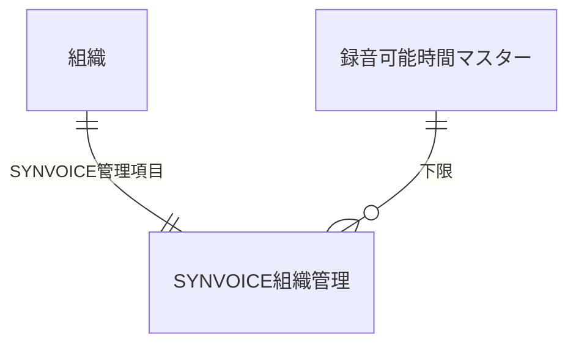

# DB設計 分割版 SYNVOICE組織管理データ構造

## 目的

SYNVOICE組織管理領域のデータ構造を整理する。

本資料では、SYNVOICE管理者が管理する組織・契約系項目、組織IDの扱い、組織発行時に必要となる参照関係、想定クエリを扱う。

顧客管理者が申請で変更する組織設定は `10_組織設定.md` を参照する。

---

## SYNVOICE組織管理で扱う範囲

SYNVOICE組織管理は、SYNVOICE管理者だけが設定・変更する組織単位の契約・運用条件として扱う。

ユーザ向け申請項目とは分けて扱う。

```text
SYNVOICE組織管理
  録音可能時間下限マスターID
  請求確定日
  トライアル開始日
  トライアル終了日
  サービス本利用開始日
  サービス本利用終了日
```

SYNVOICE組織管理には、顧客管理者が申請で変更できる項目は含めない。

```text
SYNVOICE組織管理に含めないもの:
  組織名
  組織設定で申請変更できる項目
  キーワード設定
  種別設定
  ユーザアカウント設定
  ユーザ向け管理アカウント詳細
```

組織名は、組織の代表名として `組織` に保持する。

組織名は `組織.組織名` を正とし、SYNVOICE組織管理には二重保持しない。

---

## 現在値の構造



キー構造は以下とする。

```text
組織
  組織ID

SYNVOICE組織管理
  組織ID
  録音可能時間下限マスターID

録音可能時間マスター
  録音可能時間マスターID
```

SYNVOICE組織管理は、1組織につき1件である。

SYNVOICE組織管理に別のSYNVOICE組織管理IDは持たせず、組織IDを主キーとする。

---

## 組織IDの扱い

現時点では、組織IDを組織の主キーとして扱う。

組織IDは、既存システム連携時の突合キーとしても扱う想定である。

```text
組織ID:
  組織の主キー
  既存システム連携の突合キー
  SYNVOICE管理者が組織発行時に指定する値
```

組織IDは、運用管理システム側で安易に自動採番しない。

既存システム側の組織IDと一致させる必要がある可能性があるためである。

組織IDの発行元は顧客確認事項とする。

ただし、顧客確認により、組織IDを主キーとして扱うことに危険要因がある場合は、運用管理システム内部用のサロゲートキーを追加する。

サロゲートキー導入を検討する条件は以下とする。

```text
既存システム側の組織IDが変更される可能性がある
既存システム側の組織IDが一意でない
同一組織に複数の既存システムIDが紐づく
既存システム移行時に組織IDが付け替わる
運用管理システム側で先に組織を作り、後から既存システムIDが決まる
組織IDに環境差分やテナント差分が含まれていて安定しない
```

その場合の候補は以下とする。

```text
組織
  組織管理主キー
    運用管理システム内部の主キー

  組織ID
    既存システム連携用の業務キー
```

現時点では、設計を複雑化させず、組織ID主キーの方針で進める。

---

## 現在値の論理テーブル構造

本章では、想定クエリで使用する範囲の論理項目だけを記載する。

作成日時、更新日時、作成者、更新者、監査項目などの詳細設計項目はここでは扱わない。

### SYNVOICE組織管理

| 論理項目 | 説明 |
| --- | --- |
| 組織ID | 親となる組織。既存システム連携の突合キー |
| 録音可能時間下限マスターID | ユーザが選択できる録音時間プラン下限を示す録音可能時間マスター。組織発行時に必須 |
| 請求確定日 | 組織ごとに請求情報を確定する毎月の日。1から31の数値として扱う |
| トライアル開始日 | トライアル利用開始日 |
| トライアル終了日 | トライアル利用終了日 |
| サービス本利用開始日 | サービス本利用開始日 |
| サービス本利用終了日 | サービス本利用終了日 |

制約の考え方:

```text
SYNVOICE組織管理:
  組織ID で一意
  録音可能時間下限マスターID は必須
```

### 録音可能時間マスター

| 論理項目 | 説明 |
| --- | --- |
| 録音可能時間マスターID | 録音可能時間プランを一意に識別するID |
| 1か月の録音可能時間 | 選択肢として表示する録音時間。下限判定に使用するため数値として扱う |
| 表示順 | 選択肢の表示順 |

録音可能時間マスターは、管理画面上でのマスターメンテナンス機能を設けない。

選択肢追加・変更はデータ投入で対応する。

`1か月の録音可能時間` は、分単位など大小比較できる数値として定義する。

---

## 録音可能時間下限の扱い

録音可能時間下限は、ユーザアカウント設定申請で選択できる `1か月の録音可能時間` の下限を制御する。

SYNVOICE組織管理には、録音可能時間の値を直接コピーせず、録音可能時間マスターを参照するキーを持つ。

録音可能時間下限マスターIDは必須とし、下限なしのNULL運用は行わない。

請求根拠としては参照しない。

請求根拠は、ユーザごとの `1か月の録音可能時間` を参照する。

```text
SYNVOICE組織管理.録音可能時間下限マスターID
  選択可能な録音時間プラン下限を示すマスターキー

ユーザー管理.1か月の録音可能時間
  請求根拠
```

請求根拠明細では、マスター変更の影響を受けないように、請求確定時点の録音時間値を保持する想定である。

---

## 請求確定日の扱い

請求確定日は、組織ごとに請求根拠明細を作成する毎月の日である。

請求確定日は実日付ではなく、月次処理における日を表す数値として扱う。

```text
例:
  請求確定日 = 25
    毎月25日に請求根拠明細を作成する

  請求確定日 = 31
    31日が存在する月は31日に請求根拠明細を作成する
    31日が存在しない月は、その月の月末日に請求根拠明細を作成する
```

請求確定日は1から31の数値を指定可能とする。

対象月に指定日が存在しない場合は、その月の月末日に丸めて判定する。

```text
請求確定日 = 29:
  2月以外は29日に処理する
  2月に29日が存在しない年は2月末日に処理する

請求確定日 = 30:
  30日が存在する月は30日に処理する
  2月は2月末日に処理する

請求確定日 = 31:
  31日が存在する月は31日に処理する
  31日が存在しない月は月末日に処理する
```

請求根拠明細作成の対象は、サービス本利用期間に該当する組織のみとする。

トライアル期間中の組織は請求根拠明細作成の対象外とする。

請求確定日と適用日が同じ日の場合、適用処理後の状態を請求対象とする。

請求根拠CSV出力後は、出力CSVをもとに単価適用、金額算出、目視確認、別管理情報参照を行い、請求金額を確定する想定である。

請求構造の詳細は、請求データ設計で検討する。

本資料では、請求確定日をSYNVOICE組織管理の組織単位項目として持つことだけを整理する。

この仕様により、SYNVOICE管理者は29、30、31を請求確定日として指定できる。

---

## 利用期間の扱い

トライアル開始日、トライアル終了日、サービス本利用開始日、サービス本利用終了日は、SYNVOICE管理者が組織発行時または運用時に設定する。

日付設定の制約は以下とする。

```text
トライアル開始日またはサービス本利用開始日のいずれかは必須
トライアル開始日、トライアル終了日は、どちらかを設定した場合は両方必須
トライアル期間とサービス本利用期間をともに設定する場合、サービス本利用開始日はトライアル終了日の翌日以降
サービス本利用終了日は、サービス解約が決定するまでは未設定
請求確定日は、サービス本利用開始日が設定されている場合は必須
```

これらの日付は、請求根拠明細作成の対象組織判定に使用する。

トライアル期間中は、ユーザアカウントの削除申請、録音権限、1か月の録音可能時間、要約メニュー数の1か月制限対象外とする。

本利用期間による申請可否への影響は設けない。

本利用終了時に顧客管理者の操作を止める場合は、ユーザ向け管理アカウントの削除または利用不可設定で制御する。

本資料では、組織単位の契約・運用条件としてSYNVOICE組織管理に保持する。

---

## 利用状態の判定

利用状態は、SYNVOICE組織管理に状態値として保持しない。

画面、既存システム、バッチ処理が必要とするタイミングで、SYNVOICE組織管理の日付から導出する。

```text
SYNVOICE組織管理に保持するもの:
  トライアル開始日
  トライアル終了日
  サービス本利用開始日
  サービス本利用終了日
  請求確定日

SYNVOICE組織管理に保持しないもの:
  利用状態
  トライアル中フラグ
  本利用中フラグ
  終了済みフラグ
```

状態値を保持しない理由は、日付変更時に状態値との不整合が発生することを避けるためである。

利用状態が必要な場合は、以下の考え方で判定する。

```sql
SELECT
    組織.組織ID,
    組織.組織名,
    CASE
        WHEN SYNVOICE組織管理.サービス本利用終了日 IS NOT NULL
         AND SYNVOICE組織管理.サービス本利用終了日 < :対象日
            THEN '利用期間終了'

        WHEN SYNVOICE組織管理.サービス本利用開始日 IS NOT NULL
         AND SYNVOICE組織管理.サービス本利用開始日 <= :対象日
         AND (
            SYNVOICE組織管理.サービス本利用終了日 IS NULL
            OR :対象日 <= SYNVOICE組織管理.サービス本利用終了日
         )
            THEN '本利用中'

        WHEN SYNVOICE組織管理.トライアル開始日 IS NOT NULL
         AND SYNVOICE組織管理.トライアル終了日 IS NOT NULL
         AND SYNVOICE組織管理.トライアル開始日 <= :対象日
         AND :対象日 <= SYNVOICE組織管理.トライアル終了日
            THEN 'トライアル中'

        ELSE '利用開始前'
    END AS 利用状態
FROM
    組織
    INNER JOIN SYNVOICE組織管理
        ON SYNVOICE組織管理.組織ID = 組織.組織ID;
```

判定の優先順は「利用期間終了」「本利用中」「トライアル中」「利用開始前」とする。開始日と終了日は各利用期間に含める。トライアル終了後からサービス本利用開始日前までに空白期間がある場合は「利用開始前」となる。

ユーザ向け画面では、Backendが導出したこの利用状態を対象組織のヘッダーへ表示する。Frontendや既存システム側で別の判定規則を持たない。

### SYNVOICE組織一覧での取得と検索

SYNVOICE運用管理者向けの組織一覧では、組織ID、組織名に加えて、利用状態判定に必要なトライアル開始日、トライアル終了日、サービス本利用開始日、サービス本利用終了日を同一の一覧取得で取得する。組織ごとに利用期間を再検索しない。

一覧に表示する利用期間はBackendで次のように選択する。

| 利用状態 | 表示に使用する期間 |
| --- | --- |
| 利用開始前 | 期間を表示しない |
| トライアル中 | トライアル開始日からトライアル終了日 |
| 本利用中 | サービス本利用開始日からサービス本利用終了日。終了日未設定を許容する |
| 利用期間終了 | サービス本利用開始日からサービス本利用終了日 |

組織一覧のステータス検索は、利用状態の名称やCASE式の結果に対する検索ではなく、選択された状態を上記の各日付条件へ変換してWHERE句へ追加する。件数取得と一覧取得は、同じ条件生成処理が返すWHERE句とバインド値を使用し、検索結果件数とページ内レコードの条件を一致させる。

動的に組み立てるSQL断片は、組織ID、組織名および定義済みの利用状態だけを受け付ける固定の条件断片とする。組織ID・組織名・対象日等の値はプレースホルダーへバインドし、入力値をSQL文字列へ連結しない。組織IDと日本語の組織名に対して `LOWER` は適用しない。

組織とSYNVOICE組織管理は組織IDで結合する。組織IDの主キーまたは一意インデックスを利用でき、想定する組織件数は数百件規模でページ取得も行うため、利用状態検索用の複合インデックスは初期実装では追加しない。実データ量や実行計画により問題が確認された場合に追加を検討する。

請求根拠明細作成では、利用状態そのものではなく、サービス本利用期間に該当するかを条件として使用する。

既存システムが直接参照する場合も、同じ日付項目から利用状態を導出する想定とする。

---

## 既存システムからの参照

SYNVOICE組織管理は、SYNVOICE管理者が設定する組織単位の現在値である。

既存システムは、トライアル状態、サービス本利用状態など、既存システム側の動作判断に必要なSYNVOICE組織管理の項目を直接参照する想定とする。

これは、申請データを日次バッチで既存システムに適用する流れとは別の扱いである。

```text
申請データ:
  顧客管理者が申請する設定
  適用日に既存システムへ反映する

SYNVOICE組織管理:
  SYNVOICE管理者が管理する組織単位の現在値
  既存システムが必要に応じて直接参照する
```

既存システムから直接参照されるため、SYNVOICE組織管理の項目意味、NULL可否、日付条件は既存システム側と共有する仕様として扱う。

既存システムからの更新は想定しない。

更新はSYNVOICE管理者向け機能で行い、既存システムは参照利用を基本とする。

物理設計では、別スキーマ参照、参照権限、参照用ビューの要否を検討する。

---

## 組織発行時の位置づけ

組織発行時は、少なくとも以下を作成する想定である。

```text
組織
SYNVOICE組織管理
ユーザ向け管理アカウント
```

組織設定、キーワード設定、種別設定、組織別要約メニュー公開設定などの初期作成方針は、`60_組織発行初期作成.md` で扱う。

SYNVOICE組織管理は、組織発行時に作成する。

作成後は、SYNVOICE管理者が即時更新できる現在値として扱う。

---

## 想定クエリ

本章のSQLは、データ構造の妥当性を確認するための擬似SQLである。

物理名ではなく、設計上の論理名で記載する。

### SYNVOICE管理者が組織管理情報を取得する

```sql
SELECT
    組織.組織ID,
    組織.組織名,
    SYNVOICE組織管理.録音可能時間下限マスターID,
    録音可能時間マスター.1か月の録音可能時間 AS 録音可能時間下限,
    SYNVOICE組織管理.請求確定日,
    SYNVOICE組織管理.トライアル開始日,
    SYNVOICE組織管理.トライアル終了日,
    SYNVOICE組織管理.サービス本利用開始日,
    SYNVOICE組織管理.サービス本利用終了日
FROM
    組織
    INNER JOIN SYNVOICE組織管理
        ON SYNVOICE組織管理.組織ID = 組織.組織ID
    INNER JOIN 録音可能時間マスター
        ON 録音可能時間マスター.録音可能時間マスターID = SYNVOICE組織管理.録音可能時間下限マスターID
WHERE
    組織.組織ID = :組織ID;
```

### ユーザアカウント設定申請で選択可能な録音時間を取得する

録音可能時間下限以上の録音時間プランを選択肢として取得する。

```sql
SELECT
    録音可能時間マスター.録音可能時間マスターID,
    録音可能時間マスター.1か月の録音可能時間
FROM
    SYNVOICE組織管理
    INNER JOIN 録音可能時間マスター AS 下限
        ON 下限.録音可能時間マスターID = SYNVOICE組織管理.録音可能時間下限マスターID
    INNER JOIN 録音可能時間マスター
        ON 録音可能時間マスター.1か月の録音可能時間 >= 下限.1か月の録音可能時間
WHERE
    SYNVOICE組織管理.組織ID = :組織ID
ORDER BY
    録音可能時間マスター.表示順;
```

### 請求確定日の対象組織を取得する

```sql
SELECT
    組織.組織ID,
    組織.組織名,
    SYNVOICE組織管理.請求確定日,
    SYNVOICE組織管理.サービス本利用開始日,
    SYNVOICE組織管理.サービス本利用終了日
FROM
    組織
    INNER JOIN SYNVOICE組織管理
        ON SYNVOICE組織管理.組織ID = 組織.組織ID
WHERE
    DAY(:バッチ対象日) = LEAST(
        SYNVOICE組織管理.請求確定日,
        DAY(LAST_DAY(:バッチ対象日))
    )
    AND SYNVOICE組織管理.サービス本利用開始日 <= :バッチ対象日
    AND (
        SYNVOICE組織管理.サービス本利用終了日 IS NULL
        OR SYNVOICE組織管理.サービス本利用終了日 >= :バッチ対象日
    );
```

### 組織発行時にSYNVOICE組織管理を作成する

```sql
BEGIN;

INSERT INTO 組織 (
    組織ID,
    組織名
)
VALUES (
    :組織ID,
    :組織名
);

INSERT INTO SYNVOICE組織管理 (
    組織ID,
    録音可能時間下限マスターID,
    請求確定日,
    トライアル開始日,
    トライアル終了日,
    サービス本利用開始日,
    サービス本利用終了日
)
VALUES (
    :組織ID,
    :録音可能時間下限マスターID,
    :請求確定日,
    :トライアル開始日,
    :トライアル終了日,
    :サービス本利用開始日,
    :サービス本利用終了日
);

COMMIT;
```

---

## 確認事項

SYNVOICE組織管理については、以下を確認事項とする。

```text
組織IDの発行元
  組織発行時の組織IDは、
  既存システム側で先に作成された組織IDを入力する方式でよいか。

組織IDの安定性
  組織IDは変更されない、一意である、既存システム移行時にも付け替わらない、
  という前提でよいか。

利用期間の制御範囲
  トライアル期間、本利用期間は、請求対象判定に使用する理解でよいか。
  トライアル期間、本利用期間がユーザ申請の可否に影響する場合、
  どの期間にどの申請操作を許可または制限するか。
  トライアル期間、本利用期間が運用管理システムへのログイン可否に影響する場合、
  どの期間にログインを許可または制限するか。

請求根拠明細出力単位
  ユーザ一覧の出力は必要。
  組織単位で出力するかは継続確認とする。

請求確定日の変更制御
  請求確定日をSYNVOICE管理者が変更できる場合、
  既に作成済みの請求根拠明細や当月請求処理への影響をどう扱うか。

請求確定日の丸め仕様
  請求確定日は1から31を指定可能とし、
  対象月に指定日が存在しない場合は月末日に丸める仕様でよいか。
```
