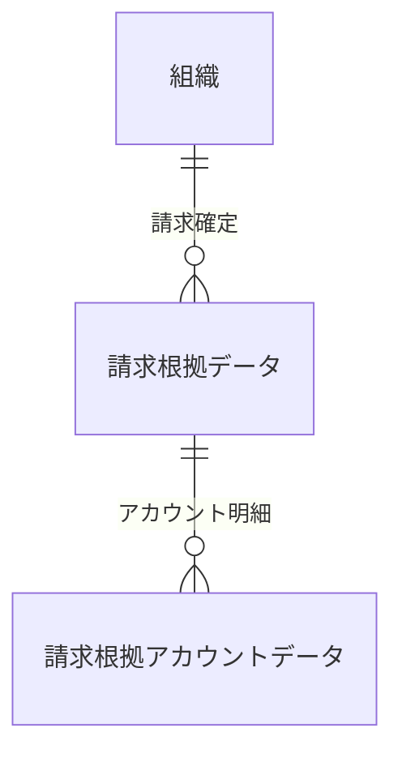

# DB設計 分割版 請求根拠明細データ構造

## 変更履歴

| 変更日 | 変更内容 | 変更理由 |
| --- | --- | --- |
| 2026-10-16 | 所属・閲覧グループを既存APIによる即時反映へ変更し、関連する保存先・参照関係を改訂。 組織登録のバッチ実行記述を登録済み確認へ修正。 | 予約申請方式を廃止するため。 |
| 2026-10-06 | 所属名の参照元表記を所属現在値に変更した。 | 所属・閲覧グループ管理の追加に合わせ、参照元の表記を関連設計書と統一するため。 |

## 目的

請求根拠明細のデータ構造を整理する。

本資料では、既存システム側の日次バッチで作成される請求根拠データ、請求根拠アカウントデータを参照し、CSV出力するための扱いを整理する。

請求根拠明細の作成処理、日次バッチ処理、請求金額の算出、単価適用、請求金額確定は本システムの管理対象外とし、本資料では扱わない。

---

## スコープ

### 本システムで扱うこと

- 既存システム側の日次バッチにより作成済みの請求根拠データを参照する。
- 既存システム側の日次バッチにより作成済みの請求根拠アカウントデータを参照する。
- 請求年月などの条件で請求根拠明細を検索する。
- 請求根拠明細をCSV出力する。

### 本システムで扱わないこと

- 請求根拠データの作成
- 請求根拠アカウントデータの作成
- 日次バッチの実行制御
- 日次バッチ失敗時の再実行制御
- 請求根拠明細の再作成
- 請求根拠明細の削除
- 請求金額の算出
- 単価適用
- 請求金額確定

---

## 既存システム側日次バッチとの関係

既存システム側の日次バッチは毎日 0:00 に実行する想定であり、以下の処理を組織別に行う。

1. 既存システムに対象の組織IDが登録済みであることを確認する。未登録の場合は当該組織の後続処理を実行しない。組織登録・初期所属の準備は組織発行フローで行う。
2. 適用日が到来した申請データを既存システムに適用する。
3. 既存システムに反映したデータを運用管理システムの現データにも反映する。
4. 適用が完了した申請データを削除する。
5. 請求確定日に請求根拠明細を作成する。

2から4のデータ処理は同一トランザクションで実行し、いずれかが失敗した場合はロールバックする。

請求根拠明細作成は、請求確定日以前の適用日に関する処理がすべて完了するまで実行されない。

請求根拠明細作成が完了するまで、請求確定日より先の適用日に関する処理は実行されない。

上記は既存システム側日次バッチの仕様であり、本システムでは作成済みデータを参照する前提とする。

---

## 基本方針

請求根拠明細は、請求根拠明細作成時点のスナップショットとして保持される。

現在値への参照ではなく、請求根拠明細作成時点の組織情報とアカウント情報が保持される。

```text
請求根拠データ
  組織単位で課金される項目のスナップショット

請求根拠アカウントデータ
  アカウント単位で課金される項目のスナップショット
```

請求根拠作成後に組織名、提供事業組織、ユーザ名、所属、録音権限、録音可能時間などが変更されても、作成済みの請求根拠明細は変更しない。

ユーザーが削除された場合でも、過去の請求根拠明細は現在値のユーザー管理とは突合しない。

---

## 請求年月

請求根拠明細には、請求根拠明細作成対象となった年月を `請求年月` として保持する。

`請求年月` は `yyyyMM` 形式の文字列として扱う。

物理設計時に文字列、数値、日付型のどれで保持するかを決定するが、本資料では論理項目として `請求年月` と表記する。

---

## 現在値との関係

請求根拠データは、親となる組織とは関連を持つ。

請求根拠アカウントデータは、ユーザー管理現在値とは外部キー関係を持たない。



請求根拠アカウントデータ側のユーザIDは、現在値のユーザー管理を参照するキーではなく、請求根拠明細作成時点のスナップショット項目として保持する。

ユーザIDは、ユーザアカウント設定で採番した `組織ID + 8桁ゼロ埋め連番` の文字列をそのまま保持する。

---

## キー構造

請求根拠データと請求根拠アカウントデータは以下の複合キーを主とする。

```text
請求根拠データ:
  PK  組織ID + 請求年月

請求根拠アカウントデータ:
  PK  組織ID + 請求年月 + ユーザID
```

請求根拠アカウントデータのユーザIDは、請求根拠明細作成時点のユーザID文字列であり、ユーザー管理現在値への外部キーではない。

ユーザID文字列には組織ID相当の接頭辞が含まれるが、請求根拠アカウントデータのキーは既存のとおり `組織ID + 請求年月 + ユーザID` とする。

---

## 論理テーブル構造

本章では、CSV出力で使用する範囲の論理項目だけを記載する。

作成日時、更新日時、作成者、更新者、監査項目などの詳細設計項目はここでは扱わない。

### 請求根拠データ

組織単位で課金される項目の保管先。

組織ID + 請求年月で一意となる。

| 論理項目 | 説明 |
| --- | --- |
| 組織ID | 対象組織の組織設定.組織ID |
| 組織名 | 請求根拠明細作成時点の組織.組織名 |
| 提供事業組織 | 請求根拠明細作成時点の組織設定.提供事業組織 |
| 請求年月 | 請求根拠明細作成対象となった年月 |
| 要約メニュー数 | 請求根拠明細作成時点の種別設定.要約メニュー数 |

### 請求根拠アカウントデータ

アカウント単位で課金される項目の保管先。

組織ID + 請求年月 + ユーザIDで一意となる。

| 論理項目 | 説明 |
| --- | --- |
| 組織ID | 対象組織の組織設定.組織ID |
| 請求年月 | 請求根拠明細作成対象となった年月 |
| ユーザID | 請求根拠明細作成時点のユーザー管理.ユーザID。`組織ID + 8桁ゼロ埋め連番` |
| ユーザ名 | 請求根拠明細作成時点のユーザー管理.ユーザ名 |
| 所属コード | 請求根拠明細作成時点のユーザー管理.所属コード |
| 所属名 | 請求根拠明細作成時点の既存所属（meetingscan_web.tm_division）の所属名。運用管理DBに所属テーブルは作成しない |
| 録音権限 | 請求根拠明細作成時点のユーザー管理.録音権限 |
| 1か月の録音可能時間 | 請求根拠明細作成時点のユーザー管理.1か月の録音可能時間 |

---

## 請求根拠明細データの保管期限

請求根拠明細データの保管期限は暫定で1年とする。

今回の開発ターゲットに、過去分の削除処理は含めない。

削除が必要な場合は、エンジニアがDBを直接削除する運用とする。

---

## ユーザー0件組織の扱い

ユーザー0件の組織も請求情報出力の対象とする。

ただし、出せないデータ、たとえばアカウント情報などは出なくて問題ない。

この場合、請求根拠データだけが作成され、請求根拠アカウントデータは0件となる。

---

## 月中に削除されたユーザーの扱い

削除申請が適用され、請求確定日前に物理削除されたユーザーは、その月の請求対象に含めない。

請求根拠アカウントデータは、請求根拠明細作成時点のユーザー管理現在値から作成される。

---

## CSV出力との関係

請求根拠CSVは、請求根拠データと請求根拠アカウントデータをもとに出力する。

ユーザー単位のCSVでは、請求根拠データと請求根拠アカウントデータを結合して出力する。

```text
CSV 1行:
  請求根拠データの組織単位情報
  請求根拠アカウントデータのアカウント単位情報
```

出力CSVをもとにした単価適用、金額算出、目視確認、別管理情報参照は、本システム外の運用として扱う。

---

## 想定クエリ

本章のSQLは、CSV出力時の参照方法を確認するための擬似SQLである。

物理名ではなく、設計上の論理名で記載する。

### 請求根拠CSVを出力する

ユーザー単位のCSVは、請求根拠データと請求根拠アカウントデータを結合して出力する。

```sql
SELECT
    請求根拠データ.組織ID,
    請求根拠データ.組織名,
    請求根拠データ.提供事業組織,
    請求根拠データ.請求年月,
    請求根拠データ.要約メニュー数,
    請求根拠アカウントデータ.ユーザID,
    請求根拠アカウントデータ.ユーザ名,
    請求根拠アカウントデータ.所属コード,
    請求根拠アカウントデータ.所属名,
    請求根拠アカウントデータ.録音権限,
    請求根拠アカウントデータ.1か月の録音可能時間
FROM
    請求根拠データ
    LEFT JOIN 請求根拠アカウントデータ
        ON 請求根拠アカウントデータ.組織ID = 請求根拠データ.組織ID
       AND 請求根拠アカウントデータ.請求年月 = 請求根拠データ.請求年月
WHERE
    請求根拠データ.請求年月 = :請求年月
ORDER BY
    請求根拠データ.組織ID,
    請求根拠アカウントデータ.ユーザID;
```

LEFT JOIN とすることで、ユーザー0件組織でも請求根拠データを出力対象にできる。
